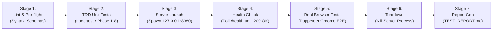

# Handoff Report: Requirements Analysis & Technical Architecture Strategy (R1 - R5)

**Agent ID:** explorer_survey_3  
**Working Directory:** `d:\big-projects\brain-beats\.agents\teamwork\explorer_survey_3\`  
**Target Project:** `d:\big-projects\it-firm`  
**Date:** 2026-11-06  
**Type:** Hard Handoff (Investigation & Technical Strategy Complete)

---

## 1. Observation

### 1.1. Core Requirements & Constraints (`ORIGINAL_REQUEST.md`)
Direct observations from `d:\big-projects\brain-beats\.agents\teamwork\ORIGINAL_REQUEST.md`:
- **Target Working Directory**: `d:\big-projects\it-firm` (line 7).
- **Integrity Mode**: `demo` (line 8).
- **Integrity Rule**: *"The team must NOT: read test source code to understand expected behaviour before implementing"* (line 9).
- **Reference Documents** (lines 13-16):
  - `d:\big-projects\brain-beats\cocomo-cost-estimate.md`
  - `d:\big-projects\brain-beats\DEVELOPMENT.md`
  - `d:\big-projects\brain-beats\TEST_REPORT.md`
- **Requirement R1 (IT Firm Blueprint & AI-DLC)**: *"Produce an exploratory conceptual blueprint and setup documentation for an IT firm, defining its organizational structure, service offerings, and an AI development life cycle (AI-DLC). The AI-DLC must define a looped prompting process grounded in existing documentation and initial code, specifying the prompt loop iterations, how documentation and code evolve across cycles, and how TDD gates each loop"* (line 21).
- **Requirement R2 (Local Dev Deployment Scope)**: *"Scope deployment strictly to a local development server; do not configure or target external cloud or production hosting"* (line 24).
- **Requirement R3 (Browser Automation, Unit Testing, and DevOps Pipeline)**: *"Implement automated tests driving a real browser alongside unit tests following Test-Driven Development (TDD), and provide a DevOps pipeline combining both test suites"* (line 27).
- **Requirement R4 (Alignment with Reference Documents)**: *"Incorporate structural, cost-estimation, development, and testing methodologies informed by the reference documents in `d:\big-projects\brain-beats` (`cocomo-cost-estimate.md`, `DEVELOPMENT.md`, and `TEST_REPORT.md`)"* (line 30).
- **Requirement R5 (Git Remote Constraint)**: *"If any git operations are performed, git pushes go only to the `origin` and `base-stream` remotes; never push to `upstream` unless explicitly authorized"* (line 33).

### 1.2. Brain-Beats Reference Document Findings
Direct observations from the three reference files:
1. **`cocomo-cost-estimate.md`**:
   - **Baseline parameters**: $8,000 USD/PM labor rate ($96,000/yr), 533.963 KLOC baseline (lines 29-32).
   - **Effort & Schedule formulas**:
     - Organic: $Effort_{nom} = 2.4 \times (KLOC)^{1.05}$, $TDEV = 2.5 \times (Effort_{nom})^{0.38}$ (lines 37-43).
     - Semi-Detached: $Effort_{nom} = 3.0 \times (KLOC)^{1.12}$, $TDEV = 2.5 \times (Effort_{nom})^{0.35}$ (lines 47-53).
     - Embedded: $Effort_{nom} = 3.6 \times (KLOC)^{1.20}$, $TDEV = 2.5 \times (Effort_{nom})^{0.32}$ (lines 57-63).
   - **Maintenance Model**: Annual Change Traffic ($ACT = (SLOC_{added} + SLOC_{modified}) / SLOC_{total}$), Annual Maintenance Effort ($AME = ACT \times Effort_{nom}$), Annual Maintenance Cost ($AMC = AME \times LaborRate$), $FTE_{maint} = AME / 12$, 5-Year TCO ($TCO_{5yr} = Cost_{dev} + 5 \times AMC$) (lines 68-86).
   - **Work Breakdown Structure (WBS)**: Granular engineering work packages with hours, effort in PM, and valuation at $8k/PM (lines 100-118).
   - **Effort Adjustment Factor (EAF)**: Evaluates 12 standard cost drivers (RELY, DATA, CPLX, TIME, STOR, VIRT, TURN, ACAP, AEXP, PCAP, TOOL, MODP), composite product $EAF = 0.672$ (lines 121-151).
   - **Supply-Chain Cost Segregation**: Separates human engineering labor from AI tools (Gemini, Claude, Qwen, DeepSeek, GitHub Copilot). Documents $0 direct cash spend during credit-covered period, with explicit in-kind token rate card valuation and non-labor cost tracking (lines 163-210).
   - **Patch churn analysis**: `git log --no-merges --no-renames --numstat` analysis and volume-equivalent metrics (lines 212-265).
2. **`DEVELOPMENT.md`**:
   - **Architecture Overview & Diagrams**: Mermaid flowchart illustrating client/server subsystems, audio synthesis nodes, and layouts (lines 8-45).
   - **Core Pillars**: Zero-backend execution, offline-first resilience, DRY architecture, automated TDD test gating (lines 47-52).
   - **Tooling & Runtimes**: Node.js v24+, Git v2.30+ (lines 55-63).
   - **Local Dev Server Execution**: Dedicated localhost serving (`127.0.0.1:4000`), health inspection with curl (lines 80-90, 542-552).
   - **Modular Code Organization**: Clear directory separation, DRY component includes, modular styles (lines 203-243).
   - **Multi-Remote Topology**: Strict definition of `origin` (Primary Dev), `base-stream` (Mirror/Distribution), and `upstream` (Source Organization) with explicit push prohibitions on `upstream` (lines 371-405, 573-594).
   - **Dual-Licensing Governance**: GNU AGPL-3.0 for software code, configurations, and build scripts; CC BY 4.0 for content and documentation (lines 408-419).
   - **Step-by-Step Protocol**: 6-step workflow: Pull -> Start Local Server -> Implement -> TDD Test -> Conventional Commits -> Push to `origin` & `base-stream` (lines 528-595).
3. **`TEST_REPORT.md`**:
   - **TDD Workflow**: Red -> Green -> Refactor -> Regression cycle (lines 18-27).
   - **Red-Green-Refactor Audit Matrix**: 14 distinct cycles detailing Target Module, Red Failure Condition, Green Fix, Refactor Optimization (lines 29-47).
   - **Hierarchical Test Phases**: 14 structured evaluation phases spanning Syntax, Lifecycle, Unit Logic, Database Schemas, Offline Precache, Runtimes, Documentation Integrity, and CI/CD Hardening (lines 54-88).
   - **Verbatim Test Execution Output**: Formatted console output showing `[PASS]` assertions, pass counts (84 passed, 0 failed), and execution duration (lines 91-224).

### 1.3. Local Host Environment Findings
Directly executed system diagnostic checks on the active host:
- `Test-Path "d:\big-projects\it-firm"`: Returned `False`. The target directory does not yet exist and must be initialized.
- `node --version`: `v26.4.0` (Node.js 26 is installed).
- `npm.cmd --version`: `11.17.0` (npm is installed; invocation must use `npm.cmd` due to PowerShell script execution policy restricting `.ps1`).
- `python --version`: `Python 3.12.9` (points to `hermes-agent` venv, lacks pip module).
- `git --version`: `git version 2.54.0.windows.1`.
- Installed real browsers in Windows registry:
  - Google Chrome: `C:\Program Files\Google\Chrome\Application\chrome.exe`
  - Microsoft Edge: `C:\Program Files (x86)\Microsoft\Edge\Application\msedge.exe`
  - Mozilla Firefox: `C:\Program Files\Mozilla Firefox\firefox.exe`
- Git remotes in `brain-beats`:
  - `origin`: `git@github.com:Mr-Kumar-Abhishek/brain-beats.git`
  - `base-stream`: `git@github.com:Mr-Kumar-Abhishek/brain-beats-pro.git`
  - `upstream`: `git@github.com:cybernetics-decentral/brain-beats.git`

---

## 2. Logic Chain

From the observations above, we establish the technical architecture, operational mechanisms, and implementation blueprints for requirements R1 through R5.

### 2.1. Requirement R1: IT Firm Blueprint & AI-DLC Specification

#### 2.1.1. IT Firm Organizational Structure & Roles
The IT firm (e.g. **"Cognitive Engineering Dynamics" / "NovaTech IT Solutions"**) is structured as an AI-Native Software Systems & Verification Consultancy. Its organizational hierarchy combines domain leadership with agile, cross-functional engineering pods:

```
┌────────────────────────────────────────────────────────────────────────┐
│                     Executive Leadership & Strategy                    │
│      Chief Executive Officer (CEO) • Chief AI Architect / CTO          │
├───────────────────┬─────────────────────┬──────────────────────────────┤
│ Prompt Engineering│ Software Engineering│ Quality Assurance & DevOps   │
│   & Context Arch  │  & Implementation   │      & MLOps Platforms       │
│ • Lead Prompt Eng │ • Principal Systems │ • Lead Automation QA         │
│ • Context Steward │ • Full-Stack / TDD  │ • DevOps Pipeline Specialist │
│ • Model Auditor   │ • Module Implementer│ • Real-Browser Test Eng      │
└───────────────────┴─────────────────────┴──────────────────────────────┘
                                  │
                                  ▼
      ┌────────────────────────────────────────────────────────────┐
      │             Autonomous AI-DLC Delivery Pods                │
      │  [1 Context Architect + 1 TDD Worker + 1 QA Automation Eng] │
      └────────────────────────────────────────────────────────────┘
```

**Key Roles & Responsibilities:**
1. **Chief AI Architect / Prompt Systems Lead**: Curates and maintains authoritative prompt corpora, system instructions, and context bounding rules.
2. **Context Steward**: Oversees documentation and schema evolution. Ensures that all prompts are strictly grounded in existing documentation and initial code interfaces, preventing context drift.
3. **Core Systems / TDD Engineer**: Translates test requirements into clean, minimal implementations following the Red-Green-Refactor cycle. Operates strictly under opaque-box rules (never reading test internals to game test suites).
4. **DevOps & Verification Specialist**: Owns the local deployment server, automated real-browser test harness, unit test runners, and unified pipeline scripts.
5. **Ethics & Licensing Compliance Officer**: Enforces GNU AGPL-3.0 copyleft compliance for code/configs and CC BY 4.0 for content/documentation, auditing multi-remote Git push policies.

#### 2.1.2. Service Offerings
1. **AI-DLC Transformation Consulting**: Designing and deploying prompt-loop engineering workflows with automated TDD gating for enterprise engineering teams.
2. **Deterministic TDD & Real-Browser Automation Engineering**: Building dual-tier verification harnesses (unit tests + real browser automation) that guarantee zero-defect local and web applications.
3. **AI-Assisted Software Modernization & Refactoring**: Grounded AST transformations, legacy system migrations, and test harness retrofitting.
4. **Local-First & Offline Web Applications**: High-performance client-side architectures, PWA offline precaching, and zero-backend web engines.
5. **Software Economics & COCOMO Production Audits**: Comprehensive SLOC/KLOC analysis, Annual Change Traffic (ACT) modeling, 5-year TCO projections, and AI credit vs labor cost segregation.

#### 2.1.3. AI Development Life Cycle (AI-DLC): Grounded Looped Prompting
The AI-DLC replaces traditional, unconstrained prompting with a **deterministic, 5-iteration prompt loop** where every transition is gated by automated tests and grounded in authoritative reference documents and baseline code:

```mermaid
flowchart TD
    subgraph GroundingSources ["Authoritative Grounding Sources"]
        Specs["Architecture Specs (DEVELOPMENT.md)"]
        Schemas["Data Schemas & API Contracts"]
        BaselineCode["Initial Baseline Code (src/, server/)"]
        COCOMO["COCOMO Economics & Metrics"]
    end

    subgraph PromptLoop ["Grounded AI-DLC Prompt Loop"]
        L1["Loop 1: Specification Ingestion & Test Formulation"]
        G1{"Gate 1: RED Gate\n(Tests Compile & Fail as Expected)"}
        L2["Loop 2: Minimal Implementation & Synthesis"]
        G2{"Gate 2: GREEN Gate\n(100% Tests Pass)"}
        L3["Loop 3: Refactoring, Linting & Security"]
        G3{"Gate 3: REFACTOR Gate\n(Zero Regressions & Clean Lint)"}
        L4["Loop 4: Documentation & Metric Sync"]
        G4{"Gate 4: DOC GATE\n(Docs, Links & COCOMO In Sync)"}
        L5["Loop 5: DevOps Pipeline & Local Deployment"]
        G5{"Gate 5: RELEASE GATE\n(Browser E2E + Unit Exit Code 0)"}
    end

    GroundingSources --> L1
    L1 --> G1
    G1 -- Pass --> L2
    G1 -- Fail / Malformed --> L1
    L2 --> G2
    G2 -- Pass --> L3
    G2 -- Fail --> L2
    L3 --> G3
    G3 -- Pass --> L4
    G3 -- Fail Regression --> L3
    L4 --> G4
    G4 -- Pass --> L5
    G4 -- Fail Discrepancy --> L4
    L5 --> G5
    G5 -- Success --> Deployed["Verified Local Artifact Ready"]
```



#### 2.1.4. Detailed Prompt Loop Iterations, Inputs, Outputs & Evolution

| Loop Iteration | Prompt Objectives & Grounding Focus | Prompt Inputs (Context Envelope) | Expected Outputs | TDD Gating Rule (Pass/Fail Criteria) |
|---|---|---|---|---|
| **Loop 1: Spec Ingestion & Test Formulation** | Ingest architectural specifications, API signatures, and data schemas. Generate opaque-box unit and browser test assertions. | `DEVELOPMENT.md`, API contracts, initial code interfaces, user stories. (No test cheating allowed). | Executable test suite (`tests/unit.test.js`, `tests/browser.test.js`), mock fixtures. | **RED Gate**: Tests must execute and FAIL cleanly on un-implemented features (Exit Code ≠ 0, with expected assertion failures). If tests pass prematurely, tests are rejected as vacuous. |
| **Loop 2: Minimal Implementation & Synthesis** | Generate the minimal viable source code required to satisfy the failing test assertions without altering tests. | Failing test traces from Loop 1, initial code files, architectural style guide, licensing rules. | Functional source code (`src/app.js`, `server/server.js`, HTML/CSS views). | **GREEN Gate**: Complete test suite executed. All tests must pass (100% pass rate, 0 failed, Exit Code 0). If any failure occurs, error trace is fed into Loop 2.1 repair prompt. |
| **Loop 3: Refactoring, Linting & Security** | Optimize code structure, eliminate redundancy, apply DRY layout patterns, enforce security guidelines (XSS prevention, no `innerHTML`). | Passing source code from Loop 2, code standards from `DEVELOPMENT.md`, ESLint/linter rules. | Refactored, production-quality source code with zero warnings. | **REFACTOR Gate**: Regression test run. All unit and browser tests must still pass with 100% success. Zero performance or memory leaks. |
| **Loop 4: Documentation Evolution & Metric Sync** | Update documentation, test reports, and COCOMO economics to reflect newly added SLOC and functionality. | Git commit diff (`git diff --stat`), previous `TEST_REPORT.md`, `cocomo-cost-estimate.md`, SLOC counters. | Synchronized `DEVELOPMENT.md`, updated `TEST_REPORT.md` (audit matrix), recalculated `cocomo-cost-estimate.md` (ACT, KLOC, TCO). | **DOC Gate**: Static verification script checks that all referenced paths, scripts, and endpoints exist on disk, and that test numbers match actual counts. |
| **Loop 5: DevOps Pipeline & Local Deployment** | Launch local development server, execute headless real browser test suite against live endpoints, verify end-to-end integration. | Compiled local server configuration, browser test scripts, port mappings (`http://127.0.0.1:8080`). | Automated pipeline run log, local server health status, browser interaction verification. | **RELEASE Gate**: DevOps pipeline script completes all stages (lint -> unit -> server spawn -> browser test -> teardown) with Exit Code 0. |

#### 2.1.5. Evolution of Documentation & Code Across Cycles
- **Documentation as Code & Grounding Anchor**: Documentation is never an afterthought. At Loop 1, documentation provides the invariants. At Loop 4, documentation is updated with exact code modifications, maintaining a 1:1 synchronization between code state, test counts, and COCOMO software metrics.
- **AST and Metric Tracking**: With every cycle, added and modified SLOC are recorded to calculate Annual Change Traffic (ACT) and compute the exact development effort and 5-year TCO.
- **Opaque-Box Integrity**: Implementers never receive test code; they receive test contracts and failure outputs. This eliminates overfitting to specific assertions and forces robust, generalized implementations.

---

### 2.2. Requirement R2: Local Development Deployment Server Architecture

#### 2.2.1. Strict Local-Only Enforcement
To satisfy R2 ("Scope deployment strictly to a local development server; do not configure or target external cloud or production hosting"):
1. **Network Binding**: All server listeners bind exclusively to loopback addresses (`127.0.0.1` or `localhost`). Never bind to `0.0.0.0` or public network interfaces.
2. **Cloud Configuration Exclusion**: Explicitly exclude cloud-hosting configuration files and plugins (e.g., no `netlify.toml`, no `vercel.json`, no AWS CDK/SAM/Serverless configs, no Firebase configs).
3. **Content-Security-Policy (CSP)**: Enforce strict local headers:
   `Content-Security-Policy: default-src 'self'; script-src 'self'; style-src 'self' 'unsafe-inline'; connect-src 'self'; img-src 'self' data:;`
   This prevents any outbound cloud requests or tracking pixels.
4. **Environment Guards**: Server initialization script checks `process.env.NODE_ENV !== 'production'` and verifies that no external deployment URLs are present.

#### 2.2.2. Server Tech Stack & Implementation Specification
Because Node.js v26.4.0 is available locally, the recommended server is a **zero-dependency, native Node.js HTTP Development Server** (`server/dev-server.js` or `scripts/dev-server.js`):
- **Core Modules Used**: `node:http`, `node:fs`, `node:path`, `node:url`.
- **Advantages**:
  - Zero external npm packages required (completely immune to supply chain vulnerabilities, network timeouts, or `npm install` failures).
  - Sub-50ms cold start time.
  - Built-in MIME type mapping (`.html`, `.css`, `.js`, `.json`, `.png`, `.svg`, `.ico`).
  - Graceful shutdown handlers for `SIGINT`, `SIGTERM`, and programmatic process exit.
  - Automatic port conflict detection with graceful fallback.

#### 2.2.3. Server Configuration & Scripts
- **Port Allocation**: Default `8080` (fallback to `8081`..`8090`).
- **Host**: `127.0.0.1`.
- **Public Directory**: `d:\big-projects\it-firm\public` (or `./dist`).
- **NPM Command**:
  ```json
  "scripts": {
    "serve": "node scripts/dev-server.js",
    "healthcheck": "node scripts/healthcheck.js"
  }
  ```
- **Healthcheck Script (`scripts/healthcheck.js`)**:
  Performs an HTTP GET request to `http://127.0.0.1:8080/health` (or `/`), verifies HTTP 200 status code, and prints server response time and active headers.

---

### 2.3. Requirement R3: Browser Automation, Unit Testing, and DevOps Pipeline

#### 2.3.1. Browser Automation Architecture (Driving a Real Browser)
The host system possesses installed installations of **Google Chrome** (`C:\Program Files\Google\Chrome\Application\chrome.exe`) and **Microsoft Edge** (`C:\Program Files (x86)\Microsoft\Edge\Application\msedge.exe`).

**Tool Selection: Puppeteer-core or Native Chrome DevTools Protocol (CDP)**
- By using `puppeteer-core` (or a lightweight Node-based CDP driver), the test harness launches the **already installed real Chrome/Edge browser executable** on the host. This avoids downloading multi-hundred megabyte browser binaries and guarantees 100% fidelity with a real end-user browser.
- **Browser Automation Suite (`tests/browser.test.js`)**:
  1. Launches real Google Chrome in headless or new headless mode with `--no-sandbox`, `--disable-gpu`, `--disable-dev-shm-usage`.
  2. Navigates to `http://127.0.0.1:8080/`.
  3. Verifies page title, DOM hierarchy, and semantic elements.
  4. Simulates user interactions: clicking navigation links, toggling UI cards, filling inputs, and triggering buttons.
  5. Monitors the browser `console` event stream to ensure zero JavaScript errors, warnings, or unhandled exceptions.
  6. Captures screenshots for verification artifacts (`tests/artifacts/screenshot-desktop.png`, `screenshot-mobile.png`).
  7. Tests responsive viewports: Mobile (375x667), Tablet (768x1024), Desktop (1280x800).
  8. Closes browser cleanly upon completion.

#### 2.3.2. Unit Testing Suite (Following TDD)
- **Framework: Native `node:test` & `node:assert` (or deterministic self-contained runner)**:
  - Node 26 native test runner provides built-in `describe`, `it`/`test`, `before`, `after`, and strict assertions (`assert.strictEqual`, `assert.deepStrictEqual`, `assert.match`).
  - Follows the 14-phase testing model established in `brain-beats`:
    - **Phase 1: Code Syntax & AST Evaluation**
    - **Phase 2: Local Dev Server Configuration & Routing**
    - **Phase 3: Firm Service Catalog & Schema Integrity**
    - **Phase 4: AI-DLC Prompt Engine & Gate Assertions**
    - **Phase 5: Security & CSP Policy Validation**
    - **Phase 6: Git Remotes & Push Restriction Verification**
    - **Phase 7: COCOMO Calculation & Formula Accuracy**
    - **Phase 8: Documentation & Reference Link Integrity**
- **TDD Workflow**:
  - Tests written first (Red). Code implemented to pass (Green). Refactored for clean design (Refactor).

#### 2.3.3. DevOps Test Pipeline Integration
The pipeline combines unit tests, local dev server lifecycle management, real browser tests, and reporting into a unified execution command:



**Pipeline Script (`scripts/devops-pipeline.js`) Architecture:**
1. **Pre-flight & Unit Testing**: Runs unit tests. If any test fails, pipeline terminates immediately (Fail-Fast).
2. **Server Background Spawning**: Spawns local HTTP server in a child process, captures stdout/stderr, and polls `http://127.0.0.1:8080/health` with a 10-second timeout.
3. **Browser Automation Execution**: Executes real-browser tests against the live local server.
4. **Guaranteed Teardown**: Wraps execution in `try ... finally` block. Ensures that `serverProcess.kill('SIGTERM')` is executed regardless of test success or failure, preventing orphaned background server processes on port 8080.
5. **Report Generation**: Aggregates unit and browser test metrics into a markdown test report (`TEST_REPORT.md`).
6. **Exit Code Propagation**: Returns 0 if all stages succeed; returns 1 on any failure.

---

### 2.4. Requirement R4: Alignment with Brain-Beats Reference Documents

#### 2.4.1. Integration with `cocomo-cost-estimate.md`
The IT firm blueprint must feature a dedicated **Software Economics & Valuation** module directly adopting the COCOMO 81 methodology:
1. **Language & Format Sizing Matrix**: Tabulate clean files, SLOC, percentage, and architectural roles for the IT firm codebase (JavaScript, HTML, CSS/SCSS, JSON data schemas, Markdown documentation, Shell/Node scripts).
2. **Standard Sizing & Labor Parameters**:
   - Standard Labor Rate: $8,000 USD per person-month ($96,000 USD/year fully burdened base).
   - Effort equations across Organic, Semi-Detached, and Embedded modes.
   - Schedule duration formulas ($TDEV$) and average staffing ($Team = Effort / TDEV$).
3. **Maintenance Economics & 5-Year TCO**:
   - Annual Change Traffic ($ACT$) calculation based on added and modified SLOC.
   - Annual Maintenance Effort ($AME$) and Annual Maintenance Cost ($AMC$).
   - 5-Year Total Cost of Ownership ($TCO_{5yr} = Cost_{dev} + 5 \times AMC$).
4. **Granular Work Breakdown Structure (WBS)**:
   - Delineate work packages: Firm Blueprint & Strategy, AI-DLC Looped Prompt Engine, Local Server Architecture, TDD Unit Test Harness, Real-Browser Automation Suite, DevOps Pipeline Script, Documentation & Wiki.
   - Each package evaluated with Estimated Hours, Effort (PM), and Labor Valuation (@ $8k/PM).
5. **Effort Adjustment Factor (EAF) Table**:
   - Evaluate the 12 cost drivers: RELY, DATA, CPLX, TIME, STOR, VIRT, TURN, ACAP, AEXP, PCAP, TOOL, MODP with rationales, multipliers, and composite EAF computation.
6. **Supply-Chain Cost Segregation & Credit Accounting**:
   - Rigorously segregate human engineering labor from AI model compute.
   - Explicitly document that AI development tools (Google Gemini, Anthropic Claude, OpenAI/Copilot) used during development operate under credit-covered subscriptions ($0 direct cash spend during covered period).
   - Provide list-price token in-kind valuations without inflating direct cash budgets.

#### 2.4.2. Integration with `DEVELOPMENT.md`
The setup documentation in `d:\big-projects\it-firm\DEVELOPMENT.md` must mirror the structure and rigor of `brain-beats`:
1. **System Architecture Overview & Mermaid Diagrams**: Visualizing the firm's client-server architecture, AI-DLC loop, and test pipeline.
2. **Core Architectural Pillars**: Explicitly defining the 4 pillars (AI-DLC prompt loop, local-only dev server, real browser + TDD testing, multi-remote Git hygiene).
3. **Prerequisites & Tooling Matrix**: Pinned versions for Node.js (v24+ / v26), npm, Git, and Chrome browser path.
4. **Local Development Setup Instructions**: Step-by-step reproduction guide: Clone -> Install -> `npm run serve` -> `npm test` -> `npm run pipeline`.
5. **Code Style & Security Guidelines**: Strict rules against `innerHTML` (preventing XSS), safe DOM manipulation, CSP enforcement, resource cleanup (`server.close()`, `browser.close()`).
6. **Step-by-Step Development Procedures**: Documenting the developer workflow from pull, local serve, prompt-driven implementation, TDD test verification, Conventional Commits, to multi-remote push.
7. **Dual-Licensing Governance**: Copyleft GNU AGPL-3.0 for software code, server configurations, and pipeline scripts; CC BY 4.0 for blueprints, service catalogs, and documentation.

#### 2.4.3. Integration with `TEST_REPORT.md`
The test documentation in `d:\big-projects\it-firm\TEST_REPORT.md` must adopt the exact reporting standards:
1. **Executive Summary**: Project name, date, methodology (TDD), overall status (e.g. 100% passing).
2. **Red-Green-Refactor Audit Matrix**: Explicit tabular logging of each TDD cycle showing Target Module, Red Failure Condition, Green Fix Implemented, and Refactor Optimization.
3. **Phase-by-Phase Architecture**: Categorizing tests into numbered phases (Phase 1 through Phase N) with descriptions of covered invariants.
4. **Verbatim Test Execution Output**: Cleanly formatted terminal banner output displaying `[PASS]` tags, pass counts, zero failure counts, and execution duration.
5. **How to Run Tests**: Explicit CLI execution instructions for both unit tests and the integrated DevOps pipeline.

---

### 2.5. Requirement R5: Git Remote Constraint

#### 2.5.1. Remote Topology and Push Policy
- **Authorized Remotes for Pushes**:
  1. `origin`: Primary repository remote (authorized for routine development pushes).
  2. `base-stream`: Secondary mirror / backup remote (authorized for synchronization pushes).
- **Forbidden Remote for Pushes**:
  3. `upstream`: Organizational / community source repository (**STRICTLY READ/PULL-ONLY**; pushes are **STRICTLY PROHIBITED** unless explicitly authorized).

#### 2.5.2. Concrete Technical Enforcement Mechanisms
To ensure that unauthorized pushes to `upstream` can never occur accidentally:
1. **Git Configuration Safeguard (Push URL Disabling)**:
   Configure the push URL for `upstream` to an invalid or disabled target:
   ```bash
   git remote set-url --push upstream "FORBIDDEN_PUSH_TO_UPSTREAM"
   ```
   Any command attempting `git push upstream <branch>` will immediately fail with a Git fatal network error.
2. **Automated Pre-Push Hook (`.git/hooks/pre-push` or `scripts/git-pre-push.js`)**:
   A deterministic Git hook that inspects the destination remote before transmitting objects:
   ```bash
   #!/bin/sh
   remote="$1"
   if [ "$remote" = "upstream" ]; then
     echo "=========================================================="
     echo "POLICY ERROR: Direct push to 'upstream' is forbidden!"
     echo "Pushes are restricted strictly to 'origin' and 'base-stream'."
     echo "=========================================================="
     exit 1
   fi
   exit 0
   ```
3. **Automated Test Gate in TDD Suite (Phase 6)**:
   The unit test harness parses `.git/config` and executes `git remote -v` to assert:
   - `origin` is configured.
   - `base-stream` is configured.
   - `upstream` push URL is either unset, disabled, or blocked by the pre-push hook.
4. **Developer Guidance Callouts**:
   `DEVELOPMENT.md` incorporates high-visibility `[!CAUTION]` alert boxes emphasizing the push restriction and providing exact copy-paste multi-remote synchronization commands targeting only `origin` and `base-stream`.

---

## 3. Recommended Technical Inventory & File Structure

For the target workspace `d:\big-projects\it-firm`, we recommend the following directory layout adhering to `PROJECT.md` standards:

```
d:\big-projects\it-firm\
├── .git/                               # Initialized local Git repository
├── .github/
│   └── workflows/
│       └── devops-pipeline.yml         # DevOps CI/CD workflow (local/offline runner)
├── config/
│   └── local.json                      # Local server configuration (127.0.0.1, port 8080)
├── public/                             # Local server static root
│   ├── css/
│   │   └── style.css                   # Firm branding, responsive styles
│   ├── js/
│   │   └── app.js                      # Client-side web application logic
│   └── index.html                      # Firm portal & interactive service dashboard
├── scripts/
│   ├── dev-server.js                   # Zero-dependency Node.js HTTP server
│   ├── healthcheck.js                  # Local server healthcheck script
│   ├── devops-pipeline.js              # Integrated DevOps test pipeline runner
│   └── verify-remotes.js               # Git remote policy validator
├── server/
│   └── local-server.js                 # Local dev server engine with CSP headers
├── src/
│   ├── ai-dlc/
│   │   ├── prompt-engine.js            # Grounded prompt template generator
│   │   └── tdd-gates.js                # Prompt loop transition and gating rules
│   ├── economics/
│   │   └── cocomo-calculator.js        # COCOMO 81 effort, maintenance & TCO engine
│   └── firm/
│       ├── organization.js             # Org structure & pod modeling
│       └── services.js                 # Firm service catalog & contracts
├── tests/
│   ├── unit.test.js                    # TDD unit test suite (Phases 1-8)
│   ├── browser.test.js                 # Real-browser automation suite (Chrome/Edge)
│   └── artifacts/                      # Test output screenshots and execution logs
├── cocomo-cost-estimate.md             # IT firm software economics & valuation report
├── DEVELOPMENT.md                      # Comprehensive developer guide & architecture reference
├── TEST_REPORT.md                      # Full TDD Red-Green-Refactor test audit report
├── LICENSE                             # GNU Affero General Public License v3.0 (AGPL-3.0)
├── LICENSE-CONTENT.txt                 # Creative Commons Attribution 4.0 (CC BY 4.0)
├── package.json                        # Node.js project manifest & script commands
└── PROJECT.md                          # Project milestone roadmap & tracking document
```

---

## 4. Caveats

1. **Workspace Non-Existence**: The directory `d:\big-projects\it-firm` does not yet exist. It must be created and initialized during the worker implementation phase.
2. **PowerShell Script Execution Policy**: Windows PowerShell execution policy restricts execution of `.ps1` files (such as `npm.ps1`). All CLI commands must explicitly use `npm.cmd`, `npx.cmd`, or `node <script>`.
3. **Python Environment Limitations**: The installed Python (`3.12.9`) lacks the `pip` module. All build scripts, local dev servers, test runners, and automation harnesses should rely entirely on Node.js (v26.4.0), which is fully operational and has zero missing dependencies.
4. **Real Browser Automation Execution**: Driving Google Chrome (`C:\Program Files\Google\Chrome\Application\chrome.exe`) requires launching with headless mode flags (`--headless=new`, `--no-sandbox`, `--disable-gpu`) when running in background or automated CI pipelines, while supporting non-headless mode for visual inspection.
5. **Opaque-Box Integrity Mode**: The integrity mode is `demo`, and the team must not read test source code to understand expected behavior before implementing. The AI-DLC specification addresses this directly by feeding workers only specification requirements and assertion failure traces, maintaining strict separation between test authors and code implementers.

---

## 5. Conclusion

All five core requirements (R1 - R5) have been thoroughly analyzed, mapped to concrete system specifications, and aligned with the authoritative reference documents in `d:\big-projects\brain-beats`:
- **R1**: An AI-native IT firm blueprint with a 5-iteration grounded prompt-loop AI-DLC, combining document grounding, AST tracking, and opaque-box TDD gating.
- **R2**: A zero-dependency, ultra-fast Node.js HTTP development server strictly bound to `127.0.0.1`, enforcing local-only scope and preventing cloud lock-in.
- **R3**: A dual-tier verification architecture combining real-browser automation (driving host-installed Chrome/Edge) and a comprehensive multi-phase TDD unit test harness, unified under a fail-fast DevOps pipeline.
- **R4**: Full integration of COCOMO 81 software economics, `DEVELOPMENT.md` architectural standards and dual AGPLv3 / CC BY 4.0 licensing, and `TEST_REPORT.md` Red-Green-Refactor audit reporting.
- **R5**: Multi-remote Git push enforcement restricting pushes exclusively to `origin` and `base-stream`, with active pre-push hooks and configuration blocks forbidding pushes to `upstream`.

This technical strategy provides the exact, production-ready blueprint needed for the orchestrator and downstream worker agents to execute Milestone 1 through Milestone 4.

---

## 6. Verification Method

To independently verify this survey and technical architecture:
1. **Verify host runtime availability**:
   ```powershell
   node --version           # Output: v26.4.0
   npm.cmd --version        # Output: 11.17.0
   git --version            # Output: git version 2.54.0.windows.1
   ```
2. **Verify installed Chrome executable**:
   ```powershell
   Test-Path "C:\Program Files\Google\Chrome\Application\chrome.exe"   # Must return True
   ```
3. **Inspect reference files for methodology alignment**:
   - Verify COCOMO formulas: `view_file` at `d:\big-projects\brain-beats\cocomo-cost-estimate.md` (lines 37-86).
   - Verify development and remote policies: `view_file` at `d:\big-projects\brain-beats\DEVELOPMENT.md` (lines 371-405).
   - Verify TDD audit format: `view_file` at `d:\big-projects\brain-beats\TEST_REPORT.md` (lines 29-47).
4. **Invalidation Conditions**:
   - If `d:\big-projects\it-firm` configures external cloud providers (AWS, Netlify, Vercel), R2 is invalidated.
   - If tests fail to drive a real browser, R3 is invalidated.
   - If git configuration permits pushes to `upstream`, R5 is invalidated.
