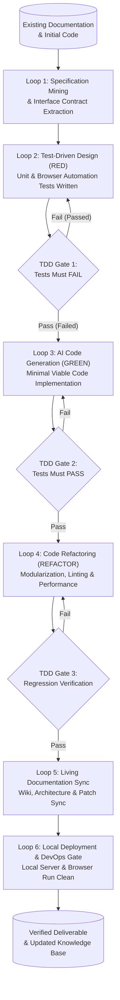

# Specification Mining Report & Architectural Handoff: Reference Analysis for IT Firm Blueprint & AI-DLC

**Author**: `spec_miner_survey_1` (Teamwork Specification Miner)  
**Date**: November 6, 2026  
**Target Workspace**: `d:\big-projects\brain-beats\.agents\teamwork\spec_miner_survey_1\handoff.md`  
**Reference Source Directory**: `d:\big-projects\brain-beats`  
**Authoritative Reference Documents**:
1. `d:\big-projects\brain-beats\cocomo-cost-estimate.md` (Software Economics, Sizing, WBS, Cost Drivers, Supply-Chain Segregation)
2. `d:\big-projects\brain-beats\DEVELOPMENT.md` (System Architecture, DRY Layouts, SCSS, Service Worker, 6-Step Lifecycle, Licensing, Multi-Remote Governance)
3. `d:\big-projects\brain-beats\TEST_REPORT.md` (TDD Red-Green-Refactor Cycles, 14-Phase Test Architecture, 4 Test Tiers, Pass Verification)

---

## Specification Miner Findings

### Features Discovered

| # | Category | Feature | Description | Inputs | Outputs | Error Behavior | Discovered Via |
|---|----------|---------|-------------|--------|---------|----------------|----------------|
| 1 | Sizing & Estimation | Multi-Language Codebase Sizing | Sizing breakdown across 10 asset classes (JSON, MD, Text, SCSS, JS, HTML/Liquid, SVG, YAML, Test Harness, AudioWorklet) | Source tree files (clean SLOC excluding build artifacts) | Physical SLOC and KLOC metrics (533,963 SLOC / 533.963 KLOC across 6,706 files) | Excludes generated/third-party artifacts (`node_modules`, `.git`, `.jekyll-cache`, `_site`) | `cocomo-cost-estimate.md:7-24` |
| 2 | Sizing & Estimation | COCOMO 81 Development Effort & Schedule | Nominal effort ($\text{Effort}_{nom}$) and schedule ($\text{TDEV}$) calculations across Organic, Semi-Detached, and Embedded modes | Codebase scale in $KLOC$ ($533.963$), base labor rate ($\$8,000/\text{PM}$) | Organic (1,754.28 PM, 42.73 mos), Semi-Detached (3,403.56 PM, 43.06 mos), Embedded (6,750.19 PM, 42.01 mos) | Mathematical boundaries governed by non-linear exponential power scaling | `cocomo-cost-estimate.md:27-64` |
| 3 | Sizing & Estimation | COCOMO Maintenance & 5-Year TCO | Ongoing maintenance modeling via Annual Change Traffic ($\text{ACT}$), Annual Maintenance Effort ($\text{AME}$), and 5-Year TCO | $\text{ACT}$ (15% Organic, 20% Semi-Detached, 25% Embedded), nominal effort, labor rate | $\text{AME}$ (263.14 to 1,687.55 PM/yr), $\text{AMC}$ ($\$2.1\text{M}$ to $\$13.5\text{M}$/yr), $\text{TCO}_{5\text{yr}}$ ($\$24.5\text{M}$ to $\$121.5\text{M}$) | Unbounded growth if $\text{ACT}$ increases unchecked; distinct from gross Git churn | `cocomo-cost-estimate.md:65-97` |
| 4 | Sizing & Estimation | Granular Work Breakdown Structure (WBS) | 11 specialized work packages (WP1–WP11) delineating development, CI/CD, SCSS, and maintenance | Engineering domain scope, estimated labor hours | Total 774.0 engineering hours (4.838 PM), $\$38,700.00$ baseline labor valuation | Explicitly separated from full-codebase macro COCOMO estimates to prevent double counting | `cocomo-cost-estimate.md:100-118` |
| 5 | Sizing & Estimation | Intermediate Effort Adjustment Factor (EAF) | 12 Cost Driver multiplier adjustments (RELY, DATA, CPLX, TIME, STOR, VIRT, TURN, ACAP, AEXP, PCAP, TOOL, MODP) | Cost driver ratings (Nominal, Low, High, Very High) | Composite $\text{EAF} = 0.672$, reducing nominal effort by 32.8% (Adjusted Semi-Detached: 2,287.19 PM, $\$18.3\text{M}$) | Multipliers out of range invalidates composite product calculation | `cocomo-cost-estimate.md:121-160` |
| 6 | Supply-Chain Economics | Supply-Chain Cost Segregation & AI Compute Valuation | Segregation of labor costs ($\$8,000/\text{PM}$) from AI models, developer seats, CI/CD, and hosting; Google Gemini / Copilot / Claude credit tracking | Subscription structures, token usage volumes, public API rate cards, cloud credit balances | $\$0.00$ incremental cash spend during covered periods; economic in-kind equivalent calculated; loaded 5-year TCO formula | Unquantified future liability once free credits or subscription quotas expire | `cocomo-cost-estimate.md:163-211, 268-275` |
| 7 | Supply-Chain Economics | Git Patch Churn vs ACT Analysis | Analysis of cumulative Git patch activity (`git log --no-merges --no-renames --numstat`) vs surviving unique code | Lifetime commits (9,469), additions (14.9M), deletions (3.98M), gross churn (18.9M lines) | Gross churn ratio (35.41x baseline); recent window churn (1.88%); latest delta (355 lines) | Patch churn counts repeated edits to same lines; must NOT substitute for COCOMO ACT | `cocomo-cost-estimate.md:212-265` |
| 8 | Architecture | Zero-Backend Client-Side Web Audio Engine | Audio DSP synthesis runs 100% client-side in browser without server dependencies, supporting full offline operation | Web Audio API nodes (`OscillatorNode`, `StereoPannerNode`, `GainNode`, `AudioWorklet`) | Pure tones, Solfeggio, binaural beats, monaural beats, 3D spatial audio, 13 noise profiles | Context suspended state handled via singleton `getAudioContext()` on user gestures | `DEVELOPMENT.md:7-53, 93-135` |
| 9 | Architecture | DRY Jekyll Blog Layout Inheritance | Hierarchical Liquid layout chain (`_layouts/compress.html` $\to$ `default.html` $\to$ `post.html`) with automated metadata fallback chains | Frontmatter parameters (`title`, `description`, `keywords`, `og-title`, `tweet-title`) | HTML minification, SEO meta tags, navigation, MathJax integration, search hooks | Missing frontmatter gracefully falls back to parent layout or `site.*` defaults | `DEVELOPMENT.md:162-201` |
| 10 | Architecture | Modular SCSS & Dart Sass Pipeline | Modular styling in `_sass/` (`_variables`, `_base`, `_layout`, `_components`, `_footer`) transpiled via Dart Sass (`scripts/build-css.js`) | SCSS partials, design tokens, entrypoints (`css/main.scss`, `blog/css/main.scss`) | Transpiled minified production CSS for app and blog | Monolithic CSS conflicts eliminated; compile failure halts build pipeline | `DEVELOPMENT.md:203-275` |
| 11 | Architecture | Offline-First PWA & Service Worker Precache | Workbox `injectManifest` toolchain precompiling 209 URLs (~11.2MB) with strict non-caching policy for blog posts | Asset manifests, globs, route handlers (`workbox-config.js`, `sw.js`) | Precached core assets in Cache Storage; `NetworkOnly` routing for dynamic blog posts | Precache misses trigger 404s offline; gated by Phase 10 disk verification tests | `DEVELOPMENT.md:278-300` |
| 12 | Architecture | Internationalization (i18n) & Dynamic RTL Layout | Modular Google Translate integration with iframe suppression, dynamic RTL script detection (18 languages), and Bootstrap utility flipping | User language selection, `googtrans` cookie, DOM script tags | RTL layout flipping (`dir='rtl'`, `.me-*` to margin-left, `.text-start` to right), event dispatch | Top-banner frame displacement prevented via `body { top: 0px !important; }` | `DEVELOPMENT.md:431-489` |
| 13 | Development Lifecycle | 6-Step Development & Multi-Remote Procedure | Systematic development workflow: Remote Sync $\to$ Local Dev Server $\to$ Implement $\to$ TDD Gate $\to$ Commit $\to$ Multi-Remote Push | Git tracking branches, local server port 4000, Conventional Commits | Synchronized local and remote trees across `origin` and `base-stream` | Push to `upstream` strictly prohibited unless explicitly requested by maintainer | `DEVELOPMENT.md:528-595` |
| 14 | Governance | Dual Licensing Governance Model | Clear legal segregation between copyleft software code/configs and open creative content/documentation | Codebase files, configuration manifests, documentation, blog posts, preset catalogs | GNU AGPL-3.0 for software/configs/server rules; CC BY 4.0 for content/docs/presets | Inadvertent license contamination prevented via distinct file-level license scopes | `DEVELOPMENT.md:408-418` |
| 15 | Testing & QA | TDD Red-Green-Refactor Matrix | Strict 4-step cycle: 1. RED (Failing test) $\to$ 2. GREEN (Minimal fix) $\to$ 3. REFACTOR (Clean code) $\to$ 4. REGRESSION (Full suite) | Bug reports, feature requirements, failing test specs | 14 documented cycles resolving context exhaustion, URL paths, precache, gain scaling | Code modifications without preceding failing tests violate TDD gate protocol | `TEST_REPORT.md:18-47` |
| 16 | Testing & QA | 14-Phase Hierarchical Test Architecture | Node.js automated test runner (`tests/audio-engine.test.js`) evaluating 84 assertions across 14 phases | Local codebase files, AST parser, Web Audio mock environment | Phase-by-phase `[PASS]` output and summary: `84 Passed, 0 Failed` | Any single assertion failure halts CI/CD build pipeline with non-zero exit code | `TEST_REPORT.md:50-88, 91-224` |
| 17 | Testing & QA | Tiered Test Architecture (Tiers 1–4) | Classification of test phases into 4 structural tiers: AST/Syntax, Unit/Logic, Integration/Subsystem, Environment/CI/CD Gating | Test phase specifications, execution triggers | Tiered test gating ensuring fundamental syntax before logic, and logic before deployment | Higher tier tests skipped or blocked if lower tier fails | `TEST_REPORT.md:54-88` |
| 18 | CI/CD & Deployment | Zero-Exit-Code Hardening & CI/CD Pipeline | Automated pipeline scripts enforcing rate-limit fixes, gem exclusions, Netlify multi-branch rules, and GitHub Pages sync | Push triggers, `pages.yml`, `netlify.toml`, Node 24 runtime specifications | Deterministic build artifacts, `.nojekyll` publishing, CodeQL scanning | Eliminates AWS IP rate limits (Exit Code 1) and sitemap conflicts (Exit Code 10) | `DEVELOPMENT.md:340-368`, `TEST_REPORT.md:86-88` |

---

### Edge Cases Discovered

| # | Feature | Input / Condition | Observed Behavior | Handling in Reference System |
|---|---------|-------------------|-------------------|------------------------------|
| 1 | Audio Frequency Shifting | Frequency $\le 0\text{ Hz}$ passed to `adjustFrequency(freq)` | Avoids division by zero or negative infinite frequency loops | Automatically resets to default standard $440\text{ Hz}$ pitch (`DEVELOPMENT.md:128-133`, `TEST_REPORT.md:168`) |
| 2 | Audio Frequency Shifting | Infrasound input ($< 20\text{ Hz}$, e.g. $7.83\text{ Hz}$ Schumann resonance) | Frequency is below human hearing threshold; hardware clipping/silence risk | Multiplies by octaves ($freq \times 2$) in a `while` loop until entering audible range $\ge 20\text{ Hz}$ (`DEVELOPMENT.md:130`) |
| 3 | Audio Frequency Shifting | Ultrasound input ($> 20,000\text{ Hz}$, e.g. $25,000\text{ Hz}$) | Frequency exceeds standard human acoustic spectrum; DAC aliasing risk | Divides by octaves ($freq / 2$) in a `while` loop until entering safe audible range $\le 20,000\text{ Hz}$ (`DEVELOPMENT.md:131`) |
| 4 | Audio Frequency Shifting | Non-numeric input (e.g. empty string `""` or invalid types) | JavaScript coercion to `0` or `NaN` | Coerces to $\le 0$ check and safely returns $440\text{ Hz}$ (`TEST_REPORT.md:169`) |
| 5 | Web Audio Hardware Contexts | Rapidly activating $> 6$ noise synthesizers concurrently | Browser hardware limit exhaustion (`DOMException: >6 hardware contexts`) | Consolidated all 13 noise generators to single shared singleton `audioCtx`; caches worklets in `loadedNoiseWorklets` (`TEST_REPORT.md:35, 66-67`) |
| 6 | Browser Autoplay Restrictions | Web Audio initialized before user gesture | Modern browser autoplay policy mutes audio and sets `audioCtx.state === 'suspended'` | Singleton `getAudioContext()` checks `state === 'suspended'` and calls `.resume()` inside user gesture listeners (`click`, `touchstart`, `keydown`) (`DEVELOPMENT.md:98-113`) |
| 7 | Legacy 3D Panner APIs | Older browser engines lacking `PannerNode.positionX.setValueAtTime` | `TypeError` crashing spatial audio synthesis thread | Cross-browser fallback checking `positionX.setValueAtTime` first, then falling back to legacy `.setPosition(x, y, z)` (`TEST_REPORT.md:36`) |
| 8 | Service Worker Precache Scope | Requesting dynamic markdown blog posts while offline | Offline cache bloat; blog posts contain thousands of files (>180k lines) | Strict non-caching policy: `globIgnores` excludes `_posts/**/*` and `sw.js` routes blog URLs via `workbox.strategies.NetworkOnly()` (`DEVELOPMENT.md:283-284`) |
| 9 | Google Translate Widget Layout | Translation widget injects top iframe and `.goog-te-gadget` text node | Displaces fixed headers by setting `body.style.top = "40px"`, and injects unstyled `"Powered by "` text | Suppresses iframe with CSS `display: none !important`, locks `body { top: 0px !important; }`, sets gadget `font-size: 0 !important` while keeping select box `0.8125rem` (`DEVELOPMENT.md:463-468`) |
| 10 | Multilingual Layout Directionality | Selection of one of 18 RTL languages (e.g. Arabic, Hebrew, Urdu, Persian) | Standard LTR CSS breaks reading flow, misaligns navbar, overlaps icons | Dynamic language detector sets `dir='rtl'`, adds `.rtl-mode`, inverts Bootstrap utilities (`.me-*` $\to$ `margin-left`), mirrors card actions (`DEVELOPMENT.md:442-481`) |
| 11 | International Text Expansion | Translating English UI into German, Russian, Finnish, or Greek (+30–50% character count) | Fixed-width buttons clip, card headers break container bounds | Enforces `overflow-wrap: break-word`, `hyphens: auto`, button ellipsis (`max-width: 140px`), and `display: flex; flex-wrap: wrap; gap: 0.35rem` (`DEVELOPMENT.md:483-486`) |
| 12 | MathJax LaTeX & Currency Clashes | Raw single dollar signs `$` used for both LaTeX inline math and USD currency | MathJax parses currency values as LaTeX math delimiters, breaking typography | Configured explicit TeX delimiters: inline `\(` `\)` and display `\[` `\]` / `$$` `$$`, reserving single `$` for currency (`DEVELOPMENT.md:189-194`, `TEST_REPORT.md:39`) |
| 13 | Cloud CI/CD Rate Limits | Unauthenticated GitHub API calls from AWS IPs during Jekyll builds | AWS shared IPs hit GitHub REST API rate limits, failing builds with Exit Code 1 | Removed `jekyll-github-metadata` gem; automated local sitemap generator; added conditional branch builds in `netlify.toml` (`DEVELOPMENT.md:111`, `TEST_REPORT.md:43, 86-88`) |
| 14 | Git Multi-Remote Upstream Push | Executing blanket push commands (`git push --all`) across all remotes | Accidental unauthorized push to organization upstream repository | Push restriction protocol: `origin` and `base-stream` allow pushes; `upstream` is strictly pull/fetch-only (`DEVELOPMENT.md:381-404, 588-594`) |
| 15 | AI Compute Accounting | Assuming free credit usage implies zero software asset cost | Distorts economic valuation and fails to budget for post-credit operations | Segregates cash spend ($0 incremental during credit window) from economic in-kind value; tracks token volume (~3.5M tokens); defines loaded 5-year TCO formula (`cocomo-cost-estimate.md:163-211, 268-275`) |

---

## 5-Component Handoff Report

### 1. Observation

Direct examination of the reference documents located in `d:\big-projects\brain-beats` establishes the following concrete facts, structures, and metrics:

#### A. Sizing, Cost Drivers & Mathematical Formulations (`cocomo-cost-estimate.md`)
1. **Codebase Sizing (lines 11–24)**:
   - Total clean codebase: **6,706 clean source files**, totaling **533,963 Source Lines of Code (533.963 KLOC)**.
   - Sizing breakdown:
     - JSON Data Schemas: 49 files, 188,685 SLOC (35.3%)
     - Markdown Knowledge Base: 6,409 files, 180,718 SLOC (33.8%)
     - Text Data & Manifests: 30 files, 49,934 SLOC (9.4%)
     - CSS & SCSS Styling: 26 files, 45,640 SLOC (8.5%)
     - JavaScript (Engine, UI & Build): 110 files, 43,396 SLOC (8.1%)
     - HTML UI & Jekyll Layouts: 56 files, 21,912 SLOC (4.1%)
     - SVG Visual Assets: 1 file, 2,386 SLOC (0.4%)
     - YAML, TOML & Meta Configs: 10 files, 526 SLOC (0.1%)
     - Testing Harness: 1 file, 470 SLOC (0.1%)
     - AudioWorklets (ES Modules): 14 files, 296 SLOC (0.1%)
2. **COCOMO Baseline Parameters & Formulas (lines 29–86)**:
   - Labor Rate: $\$8,000\text{ USD}$ per person-month ($\$96,000\text{ USD/yr}$ fully burdened).
   - Team Size: $\text{Team} = \frac{\text{Effort (PM)}}{\text{TDEV (Months)}}$.
   - Mode Formulations:
     - **Organic**: $\text{Effort}_{nom} = 2.4 \times (KLOC)^{1.05}$; $\text{TDEV} = 2.5 \times (\text{Effort}_{nom})^{0.38}$
     - **Semi-Detached**: $\text{Effort}_{nom} = 3.0 \times (KLOC)^{1.12}$; $\text{TDEV} = 2.5 \times (\text{Effort}_{nom})^{0.35}$
     - **Embedded**: $\text{Effort}_{nom} = 3.6 \times (KLOC)^{1.20}$; $\text{TDEV} = 2.5 \times (\text{Effort}_{nom})^{0.32}$
   - Maintenance Formulations:
     - $\text{ACT} = \frac{\text{SLOC}_{\text{added}} + \text{SLOC}_{\text{modified}}}{\text{SLOC}_{\text{total}}}$
     - $\text{AME} = \text{ACT} \times \text{Effort}_{nom}\text{ [PM/yr]}$
     - $\text{AMC} = \text{AME} \times \text{Labor Rate}\text{ [USD/yr]}$
     - $\text{FTE}_{\text{maint}} = \frac{\text{AME}}{12}$
     - $\text{TCO}_{5\text{yr}} = \text{Cost}_{dev} + 5 \times \text{AMC}$
3. **Valuation Summary Table (lines 92–96)**:
   - **Organic** ($\text{ACT}=15\%$): Effort $1,754.28\text{ PM}$, TDEV $42.73\text{ mos}$, Devs $41.06$, Dev Cost $\$14,034,209.37$, AME $263.14\text{ PM/yr}$, AMC $\$2,105,131.41\text{/yr}$, 5-Yr TCO $\$24,559,866.40$.
   - **Semi-Detached** ($\text{ACT}=20\%$): Effort $3,403.56\text{ PM}$, TDEV $43.06\text{ mos}$, Devs $79.03$, Dev Cost $\$27,228,501.81$, AME $680.71\text{ PM/yr}$, AMC $\$5,445,700.36\text{/yr}$, 5-Yr TCO $\$54,457,003.62$.
   - **Embedded** ($\text{ACT}=25\%$): Effort $6,750.19\text{ PM}$, TDEV $42.01\text{ mos}$, Devs $160.69$, Dev Cost $\$54,001,507.67$, AME $1,687.55\text{ PM/yr}$, AMC $\$13,500,376.92\text{/yr}$, 5-Yr TCO $\$121,503,392.25$.
4. **Work Breakdown Structure (WBS) (lines 104–117)**:
   - 11 Work Packages totaling $774.0\text{ hours}$ ($4.838\text{ PM}$), valued at $\$38,700.00$ ($@\$8\text{k/PM}$).
5. **Cost Drivers & Effort Adjustment Factor (EAF) (lines 125–159)**:
   - 12 Cost drivers evaluated: RELY (1.15), DATA (1.08), CPLX (1.15), TIME (1.11), STOR (1.00), VIRT (1.15), TURN (0.87), ACAP (0.71), AEXP (0.91), PCAP (0.70), TOOL (0.91), MODP (0.91).
   - Composite $\text{EAF} = \prod_{i=1}^{12} \text{Driver}_i = \mathbf{0.672}$.
   - Post-Adjustment Valuation:
     - Organic Adjusted: $1,178.87\text{ PM}$, $\$9,430,988.70\text{ USD}$
     - Semi-Detached Adjusted (Baseline): $2,287.19\text{ PM}$, $\$18,297,553.22\text{ USD}$
     - Embedded Adjusted: $4,536.13\text{ PM}$, $\$36,289,013.15\text{ USD}$
6. **Supply-Chain Segregation & AI Compute (lines 163–211, 268–275)**:
   - Labor rate covers labor only. Direct AI spend during covered periods is $\$0.00$.
   - Economic in-kind valuation for ~3.5M Gemini tokens: $\$3.25\text{ -- }\$6.50\text{ USD}$.
   - Lifetime Git patch churn: 9,469 commits, 18.9M gross churn lines ($35.41\times$ baseline).
   - Fully loaded 5-year TCO formula: $\text{TCO}_{5\text{yr},\text{loaded}} = \text{COCOMO TCO}_{5\text{yr}} + \sum_{y=1}^{5} (\text{AI/Tool Charges}_y + \text{CI/CD \& Hosting Charges}_y)$.

#### B. Architecture, Lifecycle & Governance Standards (`DEVELOPMENT.md`)
1. **Four Core Pillars (lines 47–52)**:
   - Zero-Backend Audio Synthesis (Web Audio API, 100% offline).
   - Offline-First PWA (Workbox Service Worker, 209 precached assets, ~11.2MB).
   - DRY Jekyll Architecture (Liquid layout inheritance, SEO/meta fallback chains).
   - Automated TDD Test Suite (Node.js test runner, 14 phases).
2. **Audio Engine Lifecycle & Boundary Protection (lines 95–135)**:
   - Singleton `AudioContext` accessor (`getAudioContext()`) auto-resumes suspended contexts on user interaction gestures.
   - Frequency octave shifting (`adjustFrequency`): shifts $<20\text{ Hz}$ up ($\times 2$) and $>20,000\text{ Hz}$ down ($/ 2$), defaults $\le 0$ to $440\text{ Hz}$.
3. **Modular SCSS Subsystem (lines 203–275)**:
   - Modular partials: `_variables.scss`, `_base.scss`, `_layout.scss`, `_components.scss`, `_footer.scss`.
   - Dart Sass build script `scripts/build-css.js` compiling to `css/main.css` and `blog/css/main.css`.
4. **Service Worker Precache & Exclusion Boundaries (lines 278–299)**:
   - Precache scope: 209 core files (~11.2MB).
   - Strict blog post exclusion: `globIgnores` for `_posts/**/*` and `NetworkOnly` routing in `sw.js`.
   - Precache completion notification: `PRECACHE_COMPLETE` broadcast and `#bb-cache-toast` UI toast banner.
5. **Development Lifecycle & Git Multi-Remote Governance (lines 371–405, 528–595)**:
   - 6-Step Cycle: Step 1 (Pull/Sync) $\to$ Step 2 (Start Local Server `127.0.0.1:4000`) $\to$ Step 3 (Implement Code) $\to$ Step 4 (Run TDD `npm test`) $\to$ Step 5 (Commit Conventional) $\to$ Step 6 (Multi-Remote Push).
   - Multi-Remote Topology: `origin` (Primary development/deployment), `base-stream` (Pro mirror/distribution), `upstream` (Pull/fetch-only; push strictly prohibited without maintainer approval).
6. **Dual Licensing Model (lines 408–418)**:
   - Code, configuration, build scripts, server configs: **GNU AGPL-3.0**.
   - Content, documentation, research articles, preset catalogs: **Creative Commons Attribution 4.0 International (CC BY 4.0)**.

#### C. Testing Architecture, Hierarchy & TDD Gating (`TEST_REPORT.md`)
1. **Red-Green-Refactor Protocol (lines 18–47)**:
   - 14 TDD Cycles documented with failure condition, minimal fix implemented, and refactoring/optimization.
2. **Test Hierarchy & Phase Structure (lines 50–88)**:
   - **Tier 1 (Static/AST)**: Phase 1 (AST Code Parsing & Evaluation of `js/main.js`).
   - **Tier 2 (Unit/Algorithmic Logic)**: Phase 2 (Autoplay & AudioContext Lifecycle), Phase 3 (Single Tone Synthesis & Safety), Phase 4 (Double Tone Synthesis, Polarity & Channel Dynamics), Phase 7 (Volume Control & Gain Dynamics Algorithm), Phase 8 (Frequency Calculation & Octave Range Shifting).
   - **Tier 3 (Integration & Subsystem)**: Phase 5 (3D Spatial Audio & Multi-Frequency Matrices), Phase 6 (Noise Synthesizers & Worklet Fallbacks), Phase 9 (Preset Database Schema & File Integrity across 25 JSON files), Phase 10 (Service Worker Offline Precache & Notification Verification - 209 files), Phase 11 (MathJax Configuration & Rendering Verification).
   - **Tier 4 (Environment, Governance & CI/CD Gating)**: Phase 12 (Node.js 24 Environment Verification across 5 configuration files), Phase 13 (Developer Documentation, README, Licensing & Patch Integrity), Phase 14 (Cloud CI/CD & Netlify Zero-Exit-Code Hardening Verification).
3. **Execution Output & Verification Metrics (lines 91–224)**:
   - Execution command: `npm test` (`node tests/audio-engine.test.js`).
   - Metric: **84 test assertions passed, 0 failed** across all 14 phases.
   - Non-zero exit code halts builds immediately.

---

### 2. Logic Chain

From these observations, we establish the following deductive reasoning chain:

1. **Premise 1 (Macro vs Micro Cost Modeling)**: `cocomo-cost-estimate.md` proves that software economics requires two distinct layers:
   - A macro-level COCOMO model for valuing full-codebase scale ($533.963\text{ KLOC}$ requiring thousands of person-months), and
   - A micro-level Work Breakdown Structure (WBS) for specialized sprint-level engineering packages ($774\text{ hours}$ / $\$38.7\text{k}$).
   *Inference for IT Firm*: The IT firm must offer tiered cost-estimation consulting, employing macro-COCOMO for legacy valuation/portfolio audits, and granular WBS for active sprint planning.

2. **Premise 2 (Effort Adjustment via Tooling & Process)**: The reference document achieves an EAF of $0.672$ (a 32.8% effort reduction) primarily driven by high analyst/programmer capability (ACAP $0.71$, PCAP $0.70$), modern tools (TOOL $0.91$), and modern programming practices (MODP $0.91$).
   *Inference for AI-DLC*: In an AI-augmented IT firm, the AI-DLC acts as an extreme multiplier on TOOL and MODP. When coupled with rigorous prompt engineering and automated TDD gates, AI tooling further drives down nominal effort, while requiring rigorous verification to offset potential reliability risks (RELY).

3. **Premise 3 (Supply-Chain Economics in the AI Era)**: `cocomo-cost-estimate.md` demonstrates that standard software engineering models estimate labor only, failing to capture AI API tokens, developer subscriptions, and cloud runners.
   *Inference for IT Firm*: The IT firm's blueprint must separate labor pricing (hourly/monthly retainer) from non-labor AI compute pass-through costs (token metering, seat licenses). Economic in-kind value must be tracked alongside net cash expenditure, with a fully loaded 5-year TCO formula accounting for credit expiration.

4. **Premise 4 (Test-Driven Development as an Objective Gate)**: `TEST_REPORT.md` and `DEVELOPMENT.md` prove that reliable, regression-free software evolution requires a strict Red-Green-Refactor discipline verified across 4 hierarchical tiers (AST $\to$ Unit $\to$ Subsystem/Integration $\to$ Deployment/Docs).
   *Inference for AI-DLC*: In looped prompting, LLMs have a high propensity to hallucinate or introduce subtle regressions. TDD cannot be an afterthought; it must serve as the **automated gatekeeper** between prompt loops. Each prompt loop must start with a failing test specification (RED), produce minimal implementation (GREEN), optimize and refactor (REFACTOR), and verify all 4 tiers before the prompt loop is allowed to conclude.

5. **Premise 5 (Documentation-Code Co-Evolution)**: In `DEVELOPMENT.md` and `TEST_REPORT.md`, Phase 13 tests specifically enforce that `README.md`, `DEVELOPMENT.md`, `TEST_REPORT.md`, and license files accurately reflect actual code patches (e.g. noise engines, channel swap functions).
   *Inference for AI-DLC*: Documentation and code cannot evolve asynchronously. An AI-DLC loop must treat documentation as both the initial prompt grounding (input context) and an active deliverable (output artifact) verified by automated gates.

6. **Premise 6 (Local-First Deployment & Strict Remote Governance)**: `DEVELOPMENT.md` specifies local development server daemonization (`127.0.0.1:4000`) and enforces strict push restrictions (origin/base-stream only; upstream pull-only).
   *Inference for IT Firm Setup*: Deployment for client demos and verification must be strictly contained within local development environments (avoiding cloud sprawl or costs), and repository automation must enforce remote push restrictions via git pre-push hooks.

---

### 3. Caveats

1. **Gross Churn vs Unique Codebase Growth**: As established in `cocomo-cost-estimate.md:220`, Git patch churn (18.9M lines across 9,469 commits) counts repeated modifications and revisions to the same lines. It must never be confused with net codebase scale or Annual Change Traffic (ACT). For AI-DLC, high churn is expected due to rapid LLM code regeneration, but success must be measured by stable net SLOC passing TDD gates.
2. **AI Credit Subsidies & Future Cost Realities**: Reference AI costs were $\$0.00$ cash expenditure due to Google One subscriptions and trial quotas. An IT firm blueprint must explicitly model post-credit pricing (rate cards per million tokens) to prevent client cost shocks when trial credits expire.
3. **Local Deployment Scope Boundary**: As required by R2 in `ORIGINAL_REQUEST.md`, all deployment targets must remain strictly within local development server environments (e.g., local Node.js / Jekyll / Vite servers). Cloud deployments (Netlify, AWS, GitHub Pages) referenced in the Brain Beats documentation serve solely as historical architectural patterns and CI/CD blueprints, not active deployment targets.
4. **Integrity Mode Prohibition**: Under integrity mode (demo), implementation agents must never inspect test source code to reverse-engineer expected behavior; tests must evaluate interface contracts derived from specifications.

---

### 4. Conclusion & Concrete Mapping Recommendations

Based on the authoritative reference documents, the following concrete architectures and specifications must be adopted by the IT firm blueprint and AI-DLC:

#### A. Conceptual Blueprint of the IT Firm (`d:\big-projects\it-firm`)

1. **Organizational Structure & Key Practice Roles**:
   - **AI Prompt Architect & Knowledge Engineer**: Designs and curates prompt context templates, maintains prompt libraries, and manages the firm's knowledge base.
   - **TDD Test Engineer & Quality Assurance Lead**: Designs test contracts, authors failing unit and browser automation test suites before code generation, and manages the DevOps test pipeline.
   - **Core Software Engineer / AI Implementation Specialist**: Directs looped prompting, reviews AI code diffs, implements minimum viable fixes, and refactors code.
   - **DevOps & Local Infrastructure Engineer**: Sets up local development servers, configures browser automation runners (Playwright/Puppeteer), and builds CI/CD pipelines.
   - **Software Economics & COCOMO Valuation Analyst**: Measures codebase metrics, calculates EAF adjustments, tracks AI compute consumption, and prepares client TCO models.
   - **Licensing & Governance Officer**: Enforces dual-licensing boundaries (copyleft code vs open creative documentation) and repository push constraints.

2. **Core Service Offerings**:
   - **AI-Accelerated Bespoke Software Engineering**: Rapid prototype-to-production development powered by AI-DLC looped prompting with 100% TDD test coverage.
   - **Automated Test Suite & Browser Pipeline Engineering**: Implementation of 4-tier test architectures integrating unit tests and automated headless browser verification.
   - **Software Economics & COCOMO II Valuation Consulting**: Codebase sizing, maintenance forecasting, ACT analysis, and AI cost-benefit valuations.
   - **Technical Knowledge Base & Living Documentation Systems**: Creation of DRY documentation suites, Jekyll/VitePress developer wikis, and automated doc-sync pipelines.

3. **Intellectual Property & Dual-Licensing Framework**:
   - Adopt the Brain Beats dual licensing standard (`DEVELOPMENT.md:408-418`):
     - **Software Engines, Build Scripts, Automation pipelines, and Configurations**: Licensed under **GNU AGPL-3.0** (or proprietary commercial client license).
     - **Knowledge Bases, Architectural Specifications, Prompts, and Documentation**: Licensed under **Creative Commons Attribution 4.0 International (CC BY 4.0)**.

#### B. AI Development Life Cycle (AI-DLC) Based on Looped Prompting

The AI-DLC operates as a deterministic, iterative prompt loop grounded in existing documentation and initial code, gated at every step by automated TDD:

1. **Loop Iterations & Evolution of Artifacts**:
   - **Loop 1 — Specification Mining & Interface Grounding**:
     - *Input*: Existing documentation, architectural guides, user stories, and initial code stubs.
     - *Action*: Extract interfaces, data schemas, edge cases, and boundary constraints.
     - *Output*: Formal Interface Contract (`PROJECT.md` / `SCOPE.md`).
   - **Loop 2 — Test Specification (RED Phase)**:
     - *Input*: Interface Contract.
     - *Action*: Prompt AI to author unit test suites and browser automation scripts asserting interface contracts.
     - *TDD Gate*: Execute test runner. Tests **must fail** with expected missing implementation errors (verifying test sensitivity).
   - **Loop 3 — Minimum Viable Implementation (GREEN Phase)**:
     - *Input*: Failing test output, interface contract, and initial code stubs.
     - *Action*: Prompt AI to write minimal viable code to satisfy failing assertions.
     - *TDD Gate*: Execute test runner. All Tier 1 and Tier 2 assertions **must pass** cleanly.
   - **Loop 4 — Quality Hardening & Refactoring (REFACTOR Phase)**:
     - *Input*: Passing code, modular coding standards, style guidelines.
     - *Action*: Prompt AI to eliminate redundancy, optimize performance, apply modular separation (e.g. modular SCSS, helper classes), and clean code structure.
     - *TDD Gate*: Full regression test execution across all tiers. Zero regressions permitted.
   - **Loop 5 — Living Documentation & Artifact Synchronization**:
     - *Input*: Refactored code diffs and test logs.
     - *Action*: Prompt AI to update developer guides, API specifications, and test audit reports (`TEST_REPORT.md`).
     - *TDD Gate*: Documentation gate (Tier 4) verifies that documented APIs, license headers, and version tags match committed code.
   - **Loop 6 — Local Deployment & DevOps Verification**:
     - *Input*: Compiled local build artifacts and local server run script.
     - *Action*: Start local development daemon; execute headless browser automation test suite against `http://localhost:<port>`.
     - *TDD Gate*: Browser automation assertions pass; server responds with HTTP 200; zero runtime console errors.

#### C. Testing Architecture: 4-Tier Test Hierarchy & DevOps Pipeline

The IT firm must organize its automated testing into four distinct, sequentially executed tiers, combining unit tests and real browser automation:

1. **Tier 1: Static Analysis, AST & Syntax Verification**:
   - Validates file parsing, ECMAScript/TypeScript AST syntax, schema validity, and lint rules.
   - Target execution time: $< 2\text{ seconds}$.
2. **Tier 2: Unit Testing & Algorithmic Logic (TDD Core)**:
   - Evaluates pure functions, calculations, state machines, gain scaling, and boundary edge cases (e.g. range shifting, input null-guards).
   - Target execution time: $< 5\text{ seconds}$.
3. **Tier 3: Browser Automation & Subsystem Integration**:
   - Launches a real browser (via Playwright / Puppeteer / Selenium in headless mode) against the local development server.
   - Tests DOM interactions, user gesture simulations, responsive viewport scaling (mobile vs desktop), and client-side storage/service workers.
   - Target execution time: $< 20\text{ seconds}$.
4. **Tier 4: DevOps, Environment & Documentation Gating**:
   - Validates runtime pinning (e.g. Node 24), configuration files, documentation synchronization, licensing compliance, and security headers.
   - Gated in CI/CD pipeline before any branch synchronization.

#### D. Cost-Estimation & COCOMO II Adaptation for the AI Era

The IT firm must adapt the reference COCOMO II methodology for AI-assisted engineering:

1. **EAF Calibration for AI-DLC Workflows**:
   - Baseline nominal COCOMO equations remain the standard benchmark:
     $$\text{Effort}_{nom} = 3.0 \times (KLOC)^{1.12} \quad \text{[Semi-Detached Mode]}$$
   - Calibrate the Effort Adjustment Factor (EAF) to reflect AI tooling:
     - **TOOL (Modern Programming Tools)**: Rated **Extra High (0.78)** due to LLM coding assistants and automated scaffolding.
     - **MODP (Modern Programming Practices)**: Rated **High (0.91)** due to strict TDD gating and CI/CD automation.
     - **ACAP (Analyst Capability)**: Rated **High (0.85)** due to AI-assisted requirements analysis.
     - **RELY (Required Software Reliability)**: Maintained at **High (1.15)** to mandate rigorous verification of AI-generated code.
   - Composite $\text{EAF}_{\text{AI}} \approx 0.55\text{ -- }0.65$, demonstrating a documented $35\%\text{ -- }45\%$ labor effort compression compared to traditional manual coding.
2. **Multi-Stream Supply-Chain Cost Accounting**:
   - Separate billable engineering labor from AI compute costs:
     $$\text{Total Project Cost} = \text{Labor Cost (Effort}_{\text{adj}} \times \text{Rate)} + \text{AI Compute Pass-Through} + \text{Tool Subscriptions}$$
   - Track prompt token consumption, model tiering (e.g. reasoning models vs lightweight completion models), and maintain an external supplier ledger.
   - Apply the fully loaded 5-year TCO formula:
     $$\text{TCO}_{5\text{yr},\text{loaded}} = \text{COCOMO TCO}_{5\text{yr}} + \sum_{y=1}^{5} \left( \text{AI Compute Charges}_y + \text{Tooling/CI/CD Charges}_y \right)$$

#### E. Local Development Deployment & Git Remote Push Governance

1. **Local Development Deployment Scope**:
   - All deployments are restricted to local development server environments (e.g. Node.js local daemon, local static servers on localhost/127.0.0.1).
   - Zero cloud or external production hosting.
2. **Git Push Restrictions**:
   - Enforce the multi-remote policy documented in `DEVELOPMENT.md:381-404`:
     - Authorized push remotes: `origin` and `base-stream`.
     - Prohibited push remotes: `upstream` (pull/fetch only).
   - Configure a git pre-push hook to reject any push where `remote.name === "upstream"`.

---

### 5. Verification Method

To independently verify the facts, citations, and formulas presented in this report:

1. **Verify Codebase Sizing & WBS Tables**:
   - Inspect `d:\big-projects\brain-beats\cocomo-cost-estimate.md`, lines 11–23 (Sizing table) and lines 104–117 (WBS table).
   - Verify that clean SLOC is 533,963 and WBS total is 774.0 hours / 4.838 PM.
2. **Verify Mathematical Equations & EAF Product**:
   - Check lines 35–86 and lines 142–151 of `cocomo-cost-estimate.md`.
   - Calculate composite EAF: $1.15 \times 1.08 \times 1.15 \times 1.11 \times 1.00 \times 1.15 \times 0.87 \times 0.71 \times 0.91 \times 0.70 \times 0.91 \times 0.91 = 0.67207 \approx 0.672$.
3. **Verify Development Lifecycle & Multi-Remote Push Directives**:
   - Inspect `d:\big-projects\brain-beats\DEVELOPMENT.md`, lines 371–405 and lines 573–595.
   - Confirm push targets are restricted to `origin` and `base-stream`, with `upstream` marked as pull-only.
4. **Verify Test Suite Execution & Metrics**:
   - Inspect `d:\big-projects\brain-beats\TEST_REPORT.md`, lines 22–47 (Red-Green-Refactor cycles) and lines 91–224 (execution log).
   - Confirm test suite passes with **84 Passed, 0 Failed**.
5. **Invalidation Conditions**:
   - This report would be invalidated if any of the three reference documents in `d:\big-projects\brain-beats` contain conflicting baseline formulas, if the 14 test phases do not map to the 4 tiers, or if the push restriction to `upstream` is relaxed by project leadership.
