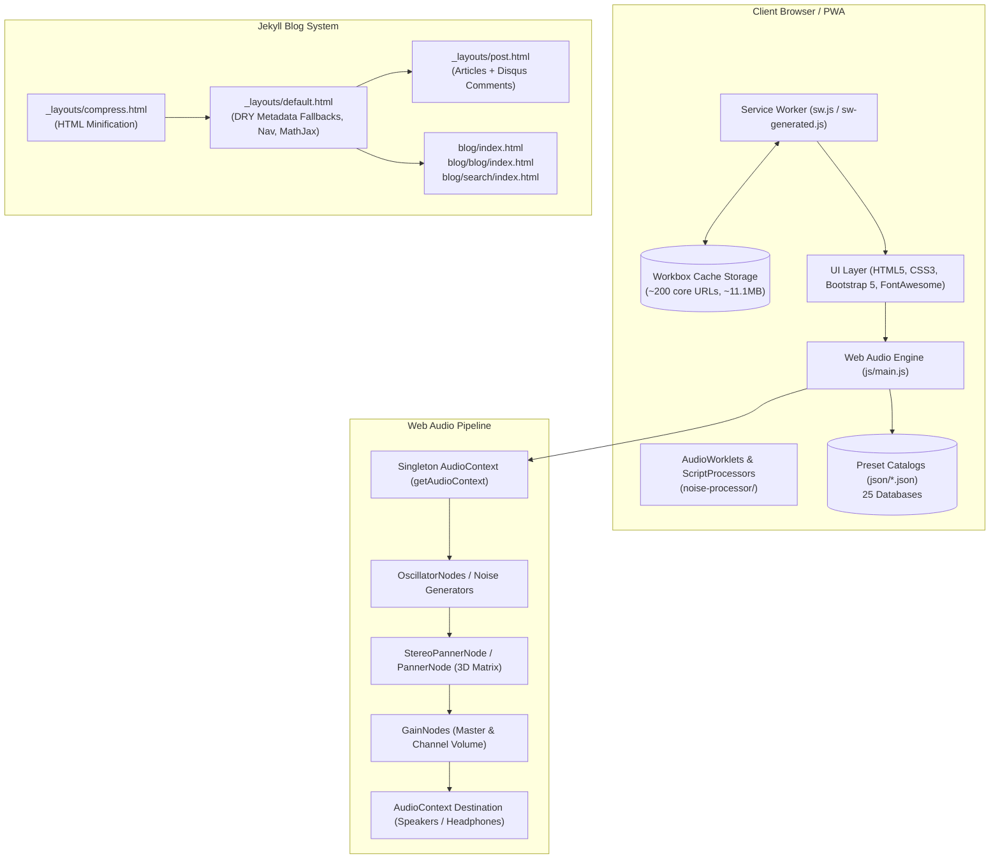
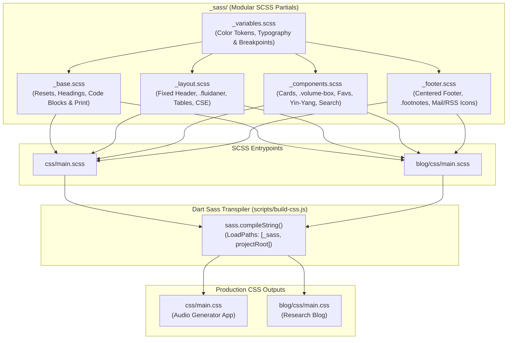

# Developer Guide & Architecture Reference

Welcome to the developer documentation for **Brain Beats**. This guide provides an in-depth reference for understanding the architecture, setting up the local development environment, testing with the TDD suite, building the PWA and Jekyll blog, and contributing to the codebase.

---

## 1. System Architecture Overview

Brain Beats is an offline-first, client-side Progressive Web Application (PWA) designed for brainwave entrainment, sound therapy, and acoustic research. It pairs a high-performance Web Audio synthesis engine with an extensive research blog powered by Jekyll.



### Core Architecture Pillars:
1. **Zero-Backend Audio Synthesis:** All frequency generation, binaural beat processing, monaural modulation, and noise shaping runs entirely client-side inside the browser using the **Web Audio API**. It functions 100% offline without needing an active internet connection.
2. **Offline-First PWA:** Service Worker precaches all core assets, application scripts, styles, audio processors, and 25 JSON preset databases.
3. **DRY Jekyll Architecture:** Clean Liquid layout inheritance with automatic fallback chains for SEO/meta tags across thousands of research articles.
4. **Automated TDD Test Suite:** Node.js-based test suite (`npm test`) validating syntax, audio lifecycle, DSP functions, JSON database integrity, and precache completeness.

---

## 2. Prerequisites & Tooling

| Requirement | Recommended Version | Purpose |
| :--- | :--- | :--- |
| **Node.js & npm** | Node v24+ / npm v10+ | Running the TDD test suite, Workbox CLI, and build tools |
| **Ruby & Bundler** | Ruby v3.0+ / Bundler v2.3+ | Building and serving the Jekyll blog engine |
| **Git** | v2.30+ | Source control and multi-remote branch synchronization |

---

## 3. Local Development Setup

### 3.1. Clone and Install Dependencies
```bash
# Clone the repository
git clone https://github.com/Mr-Kumar-Abhishek/brain-beats.git
cd brain-beats

# Install Node dependencies
npm install

# Install Ruby gems for Jekyll
bundle install
```

### 3.2. Running the Development Server
Because Brain Beats combines the main web application with the Jekyll blog engine, run the unified Jekyll development server:
```bash
npm run serve:jekyll
# or: bundle exec jekyll serve
```
- Main Application: `http://localhost:4000/`
- Blog Home: `http://localhost:4000/blog/`
- Blog Post Listing: `http://localhost:4000/blog/blog/`
- Instant Search: `http://localhost:4000/blog/search/`

---

## 4. Web Audio Engine (`js/main.js`)

### 4.1. Singleton AudioContext Lifecycle
Modern browsers restrict autoplaying audio until a user gesture occurs. The audio engine manages state gracefully via a singleton accessor:

```javascript
// Access the shared AudioContext, creating it if necessary
function getAudioContext() {
    if (!audioCtx) {
        const AudioContextClass = window.AudioContext || window.webkitAudioContext;
        if (AudioContextClass) {
            audioCtx = new AudioContextClass();
        }
    }
    if (audioCtx && audioCtx.state === 'suspended') {
        audioCtx.resume();
    }
    return audioCtx;
}
```
All user interaction triggers (`click`, `touchstart`, `keydown`) automatically invoke `getAudioContext()` to ensure seamless audio playback without browser autoplay warnings.

### 4.2. Sound Generation Modes
* **Pure Tones (`play_pure_tone(freq)`):** Single sine-wave oscillator synthesized at target frequency.
* **Solfeggio & Angel Tones (`play_solfeggio(freq)`, `play_angel(freq)`):** Sacred geometry and resonant frequency synthesis with smooth attack/decay envelope.
* **Binaural Beats (`play_binaural(leftFreq, rightFreq)`):** Two independent sine oscillators panned hard left (`pan: -1`) and hard right (`pan: +1`), producing phase-shift entrainment in the brain's superior olivary complex.
* **Monaural Beats (`play_monaural(carrier, beat)`):** Two distinct frequencies summed into a single acoustic channel before output, creating physical amplitude modulation.
* **3D Spatial Audio (`play_sine_3d_auto`, `play_XTRA_3d_auto`):** Multi-point coordinate matrix utilizing `PannerNode` / `StereoPannerNode` with periodic spatial oscillation around the listener.
* **13 Calibrated Noise Synthesizers:**
  - White, Pink, Brown, Green, Blue, Violet, Grey, Velvet, Black, Red, Yellow, Orange, and Custom noise profiles.
  - Multi-tier fallback: AudioWorklet (`noise-processor/`) -> ScriptProcessorNode -> Generated AudioBuffer.

### 4.3. Octave Range Shifting (`adjustFrequency`)
Prevents hardware clipping or silence by shifting frequencies outside human hearing range (20 Hz - 20,000 Hz) by octaves ($2^n$):
```javascript
function adjustFrequency(freq) {
    if (freq <= 0) return 440;
    while (freq < 20) freq *= 2;
    while (freq > 20000) freq /= 2;
    return freq;
}
```

---

## 5. Preset Database Architecture (`json/`)

Brain Beats includes 25 structured JSON preset collections:

| Collection | Path | Description |
| :--- | :--- | :--- |
| **Solfeggio** | `json/solfeggio.json` | Traditional 9-tone Solfeggio frequencies (174Hz - 963Hz) |
| **Binaural** | `json/binaural.json` | Delta, Theta, Alpha, Beta, Gamma brainwave states |
| **Isochronic** | `json/isochronic.json` | Isochronic pulsed amplitude rhythm presets |
| **Chakras** | `json/chakras.json` | 7 physical & higher spiritual chakra resonances |
| **Planetary** | `json/planetary.json` | Hans Cousto Cosmic Octave planetary calculations |
| **Rife** | `json/rife.json` | Royal Rife research frequencies |
| **VEGA** | `json/vega.json` | VEGA bioresonance frequency matrix |
| **XTRA** | `json/xtra.json` | Extra / Experimental laboratory frequencies |
| **PROV** | `json/prov.json` | Provocative / Proving experimental frequencies |
| **CUST** | `json/cust.json` | Custom blended frequency sets |
| **Angel** | `json/angel.json` | Numerological & angel harmonic frequencies |
| **Nogier** | `json/nogier.json` | Dr. Paul Nogier auriculo-medicine frequencies |
| **Brain** | `json/brain.json` | Neural oscillation targeting presets |

All presets are dynamically indexed by `js/search.js` and cached by the Service Worker for offline instant search.

---

## 6. Blog System & DRY Layout Hierarchy

The Jekyll blog system follows the **DRY (Don't Repeat Yourself)** layout design pattern:

```
_layouts/compress.html
  └── _layouts/default.html
        ├── _layouts/post.html
        ├── blog/index.html
        ├── blog/blog/index.html
        └── blog/search/index.html
```

### 6.1. Metadata Fallback Chains (`_layouts/default.html`)
Posts and pages only need to define unique frontmatter properties (`title`, `description`, `keywords`). Meta tags automatically fall back to parent or site values:
```html
<title>{{ page.title | default: site.name }}</title>
<meta name="keywords" content="{{ page.keywords | default: 'pure tones, solfeggio frequency, brainwave entrainment, binaural beats, isochronic tones' }}" >
<meta name="description" content="{{ page.description | default: site.description | default: page.title }}">
<meta name='subject' content="{{ page.subject | default: page.title | default: site.name }}">
<meta name="apple-mobile-web-app-title" content="{{ page.apple-title | default: page.title | default: site.name }}">
<meta name='application-name' content="{{ page.app-name | default: site.name }}">
<meta name="twitter:title" content="{{ page.tweet-title | default: page.title | default: site.name }}" >
<meta name="twitter:description" content="{{ page.tweet-description | default: page.description | default: site.description }}" >
<meta property="og:title" content="{{ page.og-title | default: page.title | default: site.name }}" >
```

### 6.2. MathJax 3 Typography Configuration (`_includes/mathjax.html`)
Mathematical formulas and calculations across Jekyll pages, blog posts, and estimation reports (e.g. [`cocomo.html`](file:///var/www/html/cocomo.html)) are rendered via MathJax 3 with support for both TeX inline `\(` `\)` and display `\[` `\]` / `$$` `$$` delimiters:
* **Configuration:** Defined modularly in [`_includes/mathjax.html`](file:///var/www/html/_includes/mathjax.html) and included across all layout chains.
* **Dual CDN & Offline Loader:** Loads primary bundle from CDN (`jsdelivr`) with an instant fallback (`onerror`) to the local precached `/blog/js/tex-mml-chtml.js` for offline PWA operation.
* **Kramdown Engine:** Configured in `_config.yml` via `kramdown.math_engine: mathjax`.

### 6.3. Generating Posts from Presets
To regenerate or batch-generate markdown posts from JSON catalogs:
```bash
python3 generate_posts.py
```

---

## 7. Modular SCSS Architecture & Dart Sass Transpiler Subsystem

Brain Beats consolidates all styling across the web audio application and the Jekyll research blog into a unified, modular SCSS architecture located in [`_sass/`](_sass).



### 7.1. SCSS Partials Breakdown (`_sass/`)
* **`_variables.scss`:** Defines global color tokens (`$primary-blue: #0000FF`, `$primary-white`, `$primary-black`, `$dark-grey`, `$fav-pink: rgb(233, 48, 94)`), base font stacks, and responsive breakpoint variables (`$breakpoint-sm: 576px`, `$breakpoint-md: 768px`, `$breakpoint-lg: 992px`, `$breakpoint-xl: 1200px`, `$breakpoint-xxl: 1400px`).
* **`_base.scss`:** Enforces global boundary rules (`html, body { overflow-x: hidden; max-width: 100vw; }`), typography scale (`h1`–`h6`), dark-themed syntax highlighting code blocks (`pre.highlight` with copy buttons), styled blockquotes, and `@media print` rules.
* **`_layout.scss`:** Glassmorphic fixed navigation header, `.fluidaner` container responsive margins/paddings, responsive table containers (`.table-wrapper`), and Google Custom Search Engine wrappers.
* **`_components.scss`:** Standardized action buttons (`.btn-play-stop`: 80px × 40px), preset cards with viewport-specific padding, floating volume dock (`.volume-box`), favorite toggle hearts (`.fav` / `.faved`), animated rotating Yin-Yang canvas, expandable search bar, and post listings.
* **`_footer.scss`:** Centered footer layout, centered licensing and contact paragraphs, centered Kramdown `.footnotes` section, and responsive FontAwesome email (`.fa-envelope`) and RSS (`.fa-square-rss`) icons.

### 7.2. Dart Sass Build Pipeline (`scripts/build-css.js`)
The transpilation script compiles the SCSS entrypoint into production CSS for both the main web application and the research blog:
```bash
# Transpile SCSS to css/main.css and blog/css/main.css
npm run build:css
# or: node scripts/build-css.js
```
The build pipeline is wired directly into `npm run build`:
```json
"scripts": {
  "build:css": "node scripts/build-css.js",
  "build:sitemap": "node scripts/generate-sitemap.js",
  "build:sw": "workbox injectManifest workbox-config.js",
  "build": "npm run build:css && npm run build:sitemap && npm run build:sw"
}
```

### 7.3. Responsive Layout & Viewport Scaling Specifications
* **Mobile Viewports (< 576px):**
  * `.fluidaner` container applies `margin-top: 80px` and compact `0.25rem` side padding to maximize screen utilization.
  * Cards span full-width `col-12` with reduced internal padding (`0.85rem 0.75rem`).
  * `.volume-box` docks as a full-width bottom bar (`width: 100%; bottom: 0; border-radius: 10px 10px 0 0;`).
* **Tablet Viewports (576px – 991px):**
  * Cards scale to `col-sm-11` (~495px) and `col-md-10` (~600px) with auto-centering margins (`mx-auto mx-sm-auto mx-md-auto mx-lg-auto mx-xl-auto mx-xxl-auto`).
  * `.volume-box` elevates into a floating pill (`500px` at 576px / `540px` at 768px, `bottom: 12px`/`15px`, `border-radius: 10px`).
* **Desktop & Ultrawide Viewports (≥ 992px, ≥ 1200px, ≥ 1400px):**
  * Proportional layout expansion via `col-*-10` to ~800px (at 992px), ~950px (at 1200px), and ~1100px (at 1400px+).
  * `.volume-box` floats centered (`600px` / `640px` / `680px`, `bottom: 20px`).
* **Centered Blog Footnotes & Touch Targets:**
  * Footnotes are centered horizontally via `.footnotes { text-align: center; margin: 2rem auto; border-top: 1px solid #d5d5d5; }` while maintaining left-aligned ordered list items via `ol { display: inline-block; text-align: left; }`.
  * Footer email and RSS feed icons scale responsively (`2rem` mobile with >44px touch targets, `2.35rem` tablet, `2.65rem` desktop with `1.12×` hover expansion).

---

## 8. Service Worker & PWA Offline Pipeline

### 8.1. Workbox Configuration & Caching Boundaries (`workbox-config.js` & `sw.js`)
Service Worker generation uses `injectManifest` with precise glob patterns and routing policies:
* **Precached Offline Scope:** All preset pages (`3d-*-presets.html`, `*frequency*.html`, `pure-tones.html`, `favorites.html`, `search.html`, etc.), generator pages (`*-generator.html`, `*machine*.html`, `index.html`), audio synthesis processors (`noise-processor/*.js`), styles, scripts, icons, manifest, and all 25 `json/*.json` database files (209 URLs, ~11.2MB).
* **Strict Non-Caching Policy for Blog Posts:** Dynamic markdown posts (`_posts/**/*`), compiled blog archives (`blog/**/*`, `_site/blog/**/*`), and post permalinks are strictly excluded from the precache via `globIgnores` in [`workbox-config.js`](workbox-config.js). Furthermore, [`sw.js`](sw.js) registers an explicit `workbox.strategies.NetworkOnly()` routing handler for `/blog/*` and date-based article paths to guarantee blog posts are never stored in PWA offline cache.

### 8.2. PWA Cache Completion Notification System
When all preset and generator pages are successfully cached into the browser's Cache Storage:
1. **Service Worker Activation (`sw.js`):** The Service Worker enters the `activate` phase, claims all clients (`clients.claim()`), issues a native Web Notification (`self.registration.showNotification`) if granted, and broadcasts a `PRECACHE_COMPLETE` message to all active client windows.
2. **Client-Side Notification Coordinator (`js/serviceLoader.js`):**
   * Automatically requests desktop notification permissions on load (`requestNotificationPermission()`).
   * Listens for `PRECACHE_COMPLETE` messages and lifecycle transitions (`updatefound`, `installed`, `activated`).
   * Displays both native system notifications and an animated in-app toast banner (`#bb-cache-toast`) confirming: *"All preset and generator pages are cached and ready for offline use."*

### 8.3. Regenerating the Service Worker
Whenever you update static assets or audio processors, recompile the Service Worker manifest:
```bash
npm run build:sw
# or: npx workbox-cli injectManifest workbox-config.js
```


---

## 9. Automated Testing & TDD Suite

Brain Beats utilizes a custom Test-Driven Development (TDD) automated test harness in [`tests/audio-engine.test.js`](tests/audio-engine.test.js).

### 9.1. Running Tests
```bash
npm test
```

### 9.2. Test Suite Phases (63 Automated Tests):
1. **Phase 1: Code Parsing & Evaluation** - Syntax checks and mock Web Audio environment evaluation.
2. **Phase 2: Autoplay & AudioContext Lifecycle** - Singleton instancing, state transitions (`suspended` -> `running`).
3. **Phase 3: Single Tone Synthesis & Parameter Safety** - Pure tone, Solfeggio, and Angel tone verification.
4. **Phase 4: Double Tone Synthesis** - Binaural & Monaural beat stereo separation and teardown.
5. **Phase 5: 3D Spatial Audio & Multi-Frequency Matrices** - PannerNode and 3-point matrix coordination.
6. **Phase 6: Noise Synthesizers & Worklet Fallbacks** - 13 calibrated noise profiles without hardware context exhaustion.
7. **Phase 7: Volume Control & Gain Dynamics Algorithm** - Dynamic `live_volume_set()`, `toggle_volume()` modulation, and volume box controls across all 38 generator pages.
8. **Phase 8: Frequency Calculation & Octave Shifting** - Boundary conditions (infrasound <20Hz, ultrasound >20kHz).
9. **Phase 9: Preset Database Schema & File Integrity** - Parsing and validating all 25 JSON catalogs.
10. **Phase 10: Service Worker Offline Precache Verification** - Verifying that every URL precached in the service worker physically exists on disk (209 URLs).
11. **Phase 11: MathJax Configuration & Rendering Verification** - TeX configuration, dynamic CDN/local fallback loader, and COCOMO LaTeX markup.
12. **Phase 12: Deployment Runtime & Node.js 24 Environment Verification** - `.node-version`, `.nvmrc`, `netlify.toml`, `package.json`, and GitHub Pages CI/CD workflow verification.
13. **Phase 13: Developer Documentation, README & Patch Integrity Verification** - Verification of `README.md`, `DEVELOPMENT.md`, `TEST_REPORT.md`, `CONTRIBUTING.md`, `cocomo-cost-estimate.md`, dual licensing scopes, and DSP synthesis programming patches.
14. **Phase 14: Cloud CI/CD & Netlify Zero-Exit-Code Hardening Verification** - Netlify multi-branch build commands, sitemap generator, canonical domain integrity, and CodeQL scanning.

For complete test logs and historical metrics, see [`TEST_REPORT.md`](TEST_REPORT.md).

---

## 10. Code Style & Security Guidelines

* **XSS Prevention:** Never use `innerHTML` when interpolating user input or JSON attributes. Use `textContent` or `DOMParser` for safe rendering.
* **Safe External Links:** Always ensure external hyperlinks specify `rel="noopener noreferrer"`.
* **Resource Cleanup:** Ensure all Web Audio oscillators, panners, and gain nodes call `.stop()` and `.disconnect()` upon termination to prevent audio buffer leaks.

---

## 11. Netlify & Cloud Deployment (`netlify.toml`)

The application is configured for automated Continuous Deployment via Netlify (backed by AWS infrastructure):

* **Build Command:** `bundle exec jekyll build && npm test && npm run build:sw`
* **Publish Directory:** `_site`
* **Runtime Versions:** Controlled via `.ruby-version` (Ruby 3.3.8) and `.node-version` (Node 24).
* **Caching & Header Policies:**
  - `sw.js` and `sw-generated.js` are served with `Cache-Control: no-cache, no-store, must-revalidate` to ensure instant client updates.
  - Audio worklets, static icons, and fonts use immutable caching (`max-age=31536000, immutable`).
  - Strict security headers (`X-Frame-Options`, `X-Content-Type-Options`, `Referrer-Policy`, `Permissions-Policy`) applied globally.
  - Domain canonicalization rules map `https://brain-beats.netlify.app/*` $\to$ `https://brain-beats.in/:splat`.

---

## 12. GitHub Pages Automated CI/CD Workflow (`.github/workflows/pages.yml`)

The project includes an automated GitHub Pages deployment workflow using official GitHub Actions (`actions/deploy-pages@v4`):

* **Trigger:** Push to `master`, `main`, or `doctor/master`, and manual dispatch (`workflow_dispatch`).
* **Dual Deployment Pipeline:**
  1. Sets up Node.js 24 (via `.node-version`) and Ruby 3.3.
  2. Runs `npm test` (TDD verification of the Web Audio engine and JSON presets).
  3. Precompiles Workbox service worker precache (`npm run build:sw`).
  4. Builds Jekyll production site into `_site` via Bundler.
  5. Bypasses Jekyll backend reprocessing (`.nojekyll`) and publishes artifact directly to GitHub Pages (`actions/deploy-pages@v4`).
  6. Automatically syncs and pushes compiled production assets to the `gh-pages` branch (`peaceiris/actions-gh-pages@v4`).
* **Custom Domain:** Configured via root [`CNAME`](CNAME) (`brain-beats.in`).

---

## 13. Multi-Remote Synchronization Workflow

This project maintains synchronized branches across three designated remotes:

| Remote Name | Repository URL | Purpose & Synchronization Role |
| :--- | :--- | :--- |
| **`origin`** | `git@github.com:Mr-Kumar-Abhishek/brain-beats.git` | **Primary Development & Deployment Remote**: Triggers automated GitHub Pages CI/CD workflows and hosts public releases across branches (`main`, `master`, `dev`, `debug`, `claude`, `gh-pages`). |
| **`base-stream`** | `git@github.com:Mr-Kumar-Abhishek/brain-beats-pro.git` | **Pro Distribution & Mirror Remote**: Secondary distribution and backup upstream mirror tracking aligned development branches (`main`, `master`, `dev`, `debug`, `claude`, `gh-pages`). |
| **`upstream`** | `git@github.com:cybernetics-decentral/brain-beats.git` | **Organization Source Remote**: Canonical organizational upstream repository for core cybernetics-decentral community tracking and integration. |

### Synchronization Rules & Push Policies

> [!IMPORTANT]
> **Push Restrictions**:
> - **`origin`** & **`base-stream`**: Standard targets for routine multi-branch pushes (`main`, `master`, `dev`, `debug`, `claude`).
> - **`upstream`**: **Pull/Fetch-Only by default**. Do **not** push to `upstream` unless explicitly instructed or requested by the maintainer.

### Synchronization Commands

```bash
# 1. Fast-forward all local tracking branches to current HEAD / main:
git branch -f master main
git branch -f dev main
git branch -f debug main
git branch -f claude main

# 2. Push unified branches to origin:
git push origin main master dev debug claude

# 3. Synchronize with base-stream mirror:
git push base-stream main master dev debug claude

# Note: Push to upstream is strictly reserved and executed ONLY when explicitly indicated.
```

---

## 14. Dual Licensing Model & Governance

Brain Beats Pro enforces a strict boundary between software engineering, configuration, and server infrastructure logic versus creative/educational content:

* **Software, Programming Mechanics, Configuration Files & Server Configurations ([`LICENSE`](LICENSE)):**
  - All application code, DSP algorithms, AudioWorklet processors, Web Audio synthesis nodes, generative mechanics, build scripts, configuration files (`package.json`, `.node-version`, `.nvmrc`, `_config.yml`, Workbox configs, CI/CD workflows), and server configurations (`netlify.toml`, web server headers, redirects, proxy rules) are copyleft protected under the **GNU Affero General Public License v3.0 (AGPL-3.0)**.
* **Content, Documentation & Presets ([`LICENSE-CONTENT.txt`](LICENSE-CONTENT.txt)):**
  - &copy; Brain Beats Pro. &copy; Brain Beats Pro. All written documentation, research guides, blog articles, and frequency preset catalogs are licensed under the **Creative Commons Attribution 4.0 International (CC BY 4.0)** license.
  - *The CC BY 4.0 license applies strictly to content and documentation, and expressly does not license the underlying software, programming, audio synthesis mechanics, configuration files, or server configurations.*

---

## 15. Framework Migration & Liquid Templating Continuity Guidelines

When evaluating or executing future framework migrations (e.g., modern SSGs, hybridized frontend architectures, or SSR frameworks):

1. **Liquid Template Preservation:** All HTML/JS program files and views that interface with the content or blog engine must preserve and implement standard **Liquid templates** (`_layouts/`, `_includes/`, and front matter bindings).
2. **Template Modularization:** Shared site headers, navigation bars, footers, MathJax equations (`_includes/mathjax.html`), SEO metadata tags, and volume control matrices must remain modularized via Liquid includes (``) to uphold the DRY (Don't Repeat Yourself) architectural principle.
3. **Dynamic Pagination & Post Routing:** Blog listings, pagination (`paginator.posts`), search indices, and category permalinks must maintain seamless compatibility with Liquid variables and loop constructs across all target framework environments.
4. **Client-Side Synthesis & Service Worker Decoupling:** Any migration must keep the Web Audio API synthesis engine (`js/main.js`), audio worklets, preset JSON catalogs, and PWA service worker precaching completely decoupled from server-rendering layers to preserve 100% offline functionality.

---

## 16. Internationalization (i18n), Google Translate & Multi-Language UX Architecture

Brain Beats provides native, seamless translation across 100+ global languages using a modular Google Translate integration combined with automated script detection, Right-to-Left (RTL) directional layout flipping, and language text expansion resilience.

### 16.1. Modular Include & Client-Side Initializer (`_includes/google-translate.html`)
The translation engine is encapsulated as a DRY Liquid template included in `_layouts/default.html` (covering all research blog posts and documentation) and in the fixed header of all 45 web app preset catalogs and audio generators:

```html
<div id="google_translate_element" class="google-translate-box my-2 my-xl-0 me-xl-2"></div>
<script type="text/javascript">
(function() {
  var rtlLanguages = {
    'ar': true, 'arc': true, 'bcc': true, 'bqi': true, 'ckb': true,
    'dv': true, 'fa': true, 'glk': true, 'he': true, 'iw': true,
    'khw': true, 'ks': true, 'ku': true, 'mzn': true, 'pnb': true,
    'ps': true, 'sd': true, 'ug': true, 'ur': true, 'yi': true
  };
  // Dynamic language detection & RTL switching logic
})();

function googleTranslateElementInit() {
  if (typeof google !== 'undefined' && google.translate && google.translate.TranslateElement) {
    new google.translate.TranslateElement({
      pageLanguage: 'en',
      autoDisplay: false
    }, 'google_translate_element');
  }
}
</script>
<script type="text/javascript" async src="https://translate.google.com/translate_a/element.js?cb=googleTranslateElementInit"></script>
```

### 16.2. Modern Banner Frame Suppression & Orphaned Text Elimination
Standard Google Translate widgets inject top banner iframes (`.goog-te-banner-frame` and modern `.VIpgJd-ZVi9od-ORHb-OEVmcd`) that displace fixed-position headers by modifying `document.body.style.top = "40px"`. Furthermore, the widget inserts an unstyled text node `"Powered by "` after the select box.
* **Iframe Suppression:** All legacy and modern translation iframe selectors are suppressed via CSS (`display: none !important; visibility: hidden !important; height: 0 !important; width: 0 !important;`).
* **Header Displacement Lock:** Forced `body { top: 0px !important; }` prevents top offset shifts on fixed-top headers.
* **Orphaned Text Removal:** Setting `.goog-te-gadget { font-size: 0 !important; color: transparent !important; }` and restoring `font-size: 0.8125rem` on `.goog-te-combo` cleanly hides the orphaned `"Powered by "` text node without affecting the combobox.
* **Hover Popup Suppression:** Translation tooltips and text highlights (`#goog-gt-tt`, `.goog-te-balloon-frame`, `.goog-text-highlight`) are suppressed to preserve pristine Bootstrap styling.

### 16.3. Dynamic Right-to-Left (RTL) Layout Engine
When an RTL language (e.g. Arabic, Hebrew, Persian/Farsi, Urdu, Pashto, Sindhi, Uyghur, Yiddish, Kurdish) is selected:
1. **Automated Detection:** The client-side script parses the selected language code from `.goog-te-combo` or the `googtrans` cookie, immediately setting `document.documentElement.dir = 'rtl'` and toggling `.rtl-mode`.
2. **Event Dispatching:** A custom DOM event `bb:languagechange` with payload `{ language, isRtl }` is broadcasted on `document`.
3. **Bootstrap Utility Flipping:** CSS rules dynamically invert directional spacing:
   - Margins: `.me-*` flips to `margin-left`, `.ms-*` flips to `margin-right`.
   - Text Alignments: `.text-start` aligns right, `.text-end` aligns left.
   - Navbar: `navbar-nav.me-auto` aligns to the right; dropdown menus open right-to-left (`right: 0; left: auto; text-align: right`).
   - Forms & Selects: Form controls align right, with `.form-select` indicators repositioned to `left: 0.75rem`.
   - Preset Cards: Favorite bookmark icons (`.fav`) mirror to the right; audio action buttons (*Swap*, *Play*, *Stop*) anchor to the left.
   - Modals: Close button (`.btn-close`) floats to the left; footer buttons align to the right edge.

### 16.4. Text Expansion & Script Safeguards
* **Text Expansion:** Translations in German, Russian, Finnish, Spanish, and Greek can expand text length by 30-50%. The UI safeguards against breaking layouts via:
  - `overflow-wrap: break-word` and `hyphens: auto` on card titles, descriptions, and dropdown items.
  - Action buttons (`.btn-play-stop`) enforce `white-space: nowrap; overflow: hidden; text-overflow: ellipsis; max-width: 140px;`.
  - Preset action container utilizes flex wrapping (`display: flex; flex-wrap: wrap; gap: 0.35rem;`), ensuring buttons stack cleanly rather than clipping on narrow screens.
* **Universal Multi-Script Font Stack:** Upgraded `$font-family-base` to a comprehensive international system stack (`-apple-system, BlinkMacSystemFont, "Segoe UI", Roboto, "Helvetica Neue", Arial, "Noto Sans", ...`), guaranteeing crisp native typography across Latin, Cyrillic, Greek, Arabic, Hebrew, Devanagari, Thai, and CJK ideographs.

---

## 17. Responsive Bootstrap 5 UX & Cross-Device Engineering

Brain Beats enforces ergonomic, mobile-first responsive design across all viewports:

| Viewport | Range | Layout & UX Behavior |
| :--- | :--- | :--- |
| **Extra Small (xs)** | `< 576px` | Compact `.fluidaner` (`margin-top: 76px; margin-bottom: 140px`), sleek floating audio dock (height: `4.25rem`, radius: `16px`, bottom: `10px`), touch targets ≥ 42px, narrow mobile buttons (`36px` height, `58px` min-width on `< 420px`). |
| **Small (sm)** | `576px – 767px` | Centered preset cards (`col-sm-11`), floating audio pill (`480px` width, bottom: `12px`), responsive card padding. |
| **Medium (md)** | `768px – 991px` | Tablet grid layout (`col-md-10`), floating audio pill (`520px` width, bottom: `15px`), expanded search bar (`max-width: 580px`). |
| **Large (lg)** | `992px – 1199px` | Desktop card expansion (~800px), floating audio dock (`560px` width, bottom: `18px`). |
| **Extra Large (xl / xxl)** | `≥ 1200px` | Full navbar expansion, floating audio dock (`600px` / `640px` width, bottom: `20px`), proportional container breathing room. |

### 17.1. Bounded Navigation Collapse with Touch Scrolling
On mobile and tablet viewports (`< 1200px`), the navigation header collapses into a Bootstrap hamburger toggler. To prevent long dropdown lists (such as the 13-item *Generators* menu or 11-item *Beats* menu) from extending beyond the visible screen:
```scss
@media (max-width: 1199.98px) {
  .navbar-collapse {
    max-height: calc(100vh - 4.5rem);
    overflow-y: auto;
    -webkit-overflow-scrolling: touch;
    padding-top: 0.5rem;
    padding-bottom: 1.5rem;
  }
}
```

### 17.2. Ergonomic Floating Audio Dock (`.volume-box`)
Replaced the legacy 128px (`8rem`) full-width block with a floating audio dock:
- Reclaims over 30% of usable vertical viewport space on mobile devices.
- Uses glassmorphic backdrop blurring (`backdrop-filter: blur(10px)`), smooth 16px corner radii, and subtle elevation shadows (`0 4px 20px rgba(0,0,0,0.14)`).
- Features uppercase micro-label typography (`font-size: 0.75rem; letter-spacing: 0.08em; font-weight: 600; text-transform: uppercase; color: #6c757d`).

### 17.3. Standardized Responsive Image Scaling
Replaced legacy global `img { width: 99%; }` rules with modern responsive scaling (`img { max-width: 100%; height: auto; }`). Fixed-dimension inline images and Google Translate branding icons specify `width: auto !important; max-width: none !important;` to eliminate stretched image distortions in blog articles and navigation headers.

---

## 18. Step-by-Step Development & Multi-Remote Synchronization Procedures

Follow these established procedures when developing, testing, and synchronizing changes across the Brain Beats ecosystem:

### 18.1. Step 1: Pull and Synchronize from Remote
Before starting any local development task, fetch and fast-forward the working tree to the latest remote state:
```bash
# Fetch all branches and prune obsolete references
git fetch --all --prune

# Pull and rebase current branch against origin/main
git pull --rebase origin main
```

### 18.2. Step 2: Start Local Development Server
Brain Beats utilizes Jekyll to transpile Sass, bind Liquid layouts, and serve both the web application and the research blog:
```bash
# Start incremental local Jekyll development daemon
bundle exec jekyll serve --host 127.0.0.1 --port 4000 --incremental

# In a separate terminal or background task, inspect local endpoints:
curl -I http://127.0.0.1:4000/
curl -I http://127.0.0.1:4000/blog/
```

### 18.3. Step 3: Implement Code & UX Enhancements
1. **Audio Synthesis & DSP:** Modify `js/main.js` using defensive null-checks, singleton AudioContext lifecycle methods, and proper node `.disconnect()` disposal.
2. **Liquid Includes & Views:** Place reusable components in `_includes/` and include them via ``.
3. **SCSS & Stylesheets:** Edit modular SCSS partials in `_sass/` (`_variables.scss`, `_base.scss`, `_layout.scss`, `_components.scss`, `_footer.scss`) and synchronize compiled production outputs in `css/main.css` and `blog/css/main.css`.
4. **Interactive Controls:** Ensure touch targets are ≥ 42px on mobile, action buttons support flex-wrapping, and form controls specify proper ARIA labels.

### 18.4. Step 4: Run Automated TDD Test Verification
Ensure all 84 test assertions pass cleanly with zero failures before committing:
```bash
npm test
# Expected output: Test Results: 84 Passed, 0 Failed
```

### 18.5. Step 5: Commit Changes Following Conventional Commits
Stage changes and format commits according to Conventional Commits:
```bash
git add -A
git commit -m "feat(scope): concise description of enhancements"
```

### 18.6. Step 6: Multi-Remote Branch Synchronization & Push Policies
Synchronize local tracking branches (`main`, `master`, `dev`, `debug`, `claude`) and push strictly to authorized distribution remotes:

```bash
# 1. Fast-forward all local tracking branches to main:
git branch -f master main
git branch -f dev main
git branch -f debug main
git branch -f claude main

# 2. Push tracking branches to origin (Primary CI/CD & GitHub Pages):
git push origin main master dev debug claude

# 3. Push tracking branches to base-stream (Pro distribution & mirror):
git push base-stream main master dev debug claude
```

> [!CAUTION]
> **Upstream Push Restriction Directive**:
> Strictly **reduce/avoid pushes towards `upstream`** (`git@github.com:cybernetics-decentral/brain-beats.git`).
> Routine pushes are strictly prohibited to `upstream` unless explicitly instructed and approved by the maintainer.

---

<div align="center">
<sub>&copy; Brain Beats Pro. Written content and documentation are licensed under <a href="LICENSE-CONTENT.txt">CC BY 4.0</a>. Software code, synthesis mechanics, and configuration files are copyleft protected under <a href="LICENSE">GNU AGPLv3</a>.</sub>
</div>
