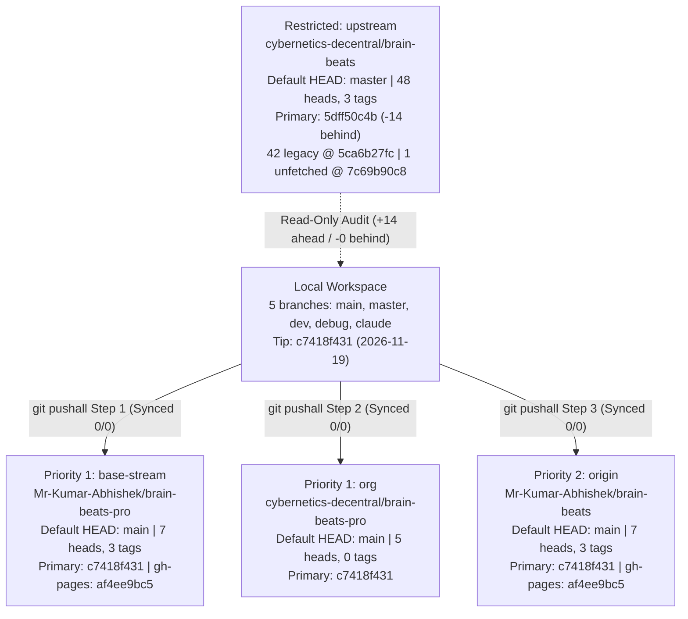

# Multi-Remote & Upstream Branch Synchronicity Report

**Project:** Brain Beats / Brain Beats Pro  
**Audit Timestamp:** November 23, 2026 (`2026-11-23 23:25 +0530`)  
**Local & Priority Remotes Tip (`main`, `master`, `dev`, `debug`, `claude`):** `c7418f4316a672ad8ef0256e12fc4b06b41e825e` (`c7418f431`, `2026-11-19 01:07:16 +0530`)  
**Upstream Primary Tip (`main`, `master`, `dev`, `debug`, `claude`):** `5dff50c4bf0f88a40645b01c164cd4f49243108f` (`5dff50c4b`, `2026-11-07 11:13:40 +0530`)  
**Scope Audited:** `4` configured remotes (`base-stream`, `org`, `origin`, `upstream`), `5` local branches, `50` distinct branch names across all remotes, `3` release tags (`0.0.1`, `v1.0.1`, `v1.0.2`), remote default `HEAD` symrefs, local Git tracking configuration, and DRY push aliases.

**Overall Status Summary:**
- **Active Primary Branches (`local`, `base-stream`, `org`, `origin`):** **100% Synchronized** across `main`, `master`, `dev`, `debug`, and `claude` at `c7418f431`.
- **Primary Branches vs. `upstream`:** **+14 commits ahead / -0 commits behind** (`10,534` files changed net, `+2,127,843` insertions, `-38,249` deletions). Clean fast-forward lineage with zero diverging `upstream` commits on those 5 branches.
- **Non-Primary & Deployment Branches (`45` branches):** `2` synced across `base-stream` and `origin` (`gh-pages`, `dependabot/npm_and_yarn/npm_and_yarn-4f720a7108`), `1` unfetched `upstream`-only branch (`dependabot/bundler/bundler-b761afa996`), and `42` historical `upstream`-only branches parked at already-merged ancestor `5ca6b27fc3a4`.
- **Release Tags & Default `HEAD` Symrefs:** `v1.0.1` and `v1.0.2` are synchronized across `local`, `base-stream`, `origin`, and `upstream` (absent on `org`); `0.0.1` diverges between `local`/`base-stream`/`origin` (`4f0006322`) and `upstream` (`798ebd5a2`) and is absent on `org`. Default `HEAD` points to `refs/heads/main` on `base-stream`, `org`, and `origin`, versus `refs/heads/master` on `upstream`.

---

## 1. Executive Summary & Multi-Remote Topology

The Brain Beats distribution pipeline coordinates five synchronized development branches (`main`, `master`, `dev`, `debug`, `claude`) from the local working directory across three active distribution remotes (`base-stream`, `org`, `origin`) while maintaining `upstream` (`cybernetics-decentral/brain-beats`) as a restricted historical/organization archive remote.



### Configured Remotes & Reference Inventory

| Remote | Role & Push Tier | SSH Repository URL | Default `HEAD` Symref | Branch Heads | Release Tags | Push Policy |
| :--- | :--- | :--- | :--- | :---: | :---: | :--- |
| **`base-stream`** | Priority 1 — Personal Pro Canonical | `git@github.com:Mr-Kumar-Abhishek/brain-beats-pro.git` | `refs/heads/main` | `7` | `3` (`5` refs) | Active (`git pushall` Step 1) |
| **`org`** | Priority 1 — Organization Pro | `git@github.com:cybernetics-decentral/brain-beats-pro.git` | `refs/heads/main` | `5` | `0` (`0` refs) | Active (`git pushall` Step 2) |
| **`origin`** | Priority 2 — Personal Fork & CI/CD Mirror | `git@github.com:Mr-Kumar-Abhishek/brain-beats.git` | `refs/heads/main` | `7` | `3` (`5` refs) | Active (`git pushall` Step 3) |
| **`upstream`** | Restricted — Organization Archive | `git@github.com:cybernetics-decentral/brain-beats.git` | `refs/heads/master` | `48` | `3` (`5` refs) | **Restricted — NO automated pushes** |

> [!NOTE]
> Annotated tags (`v1.0.1`, `v1.0.2`) expose two refs each via `git ls-remote --tags` (the tag object itself and its dereferenced `^{}` commit ref), whereas lightweight tag `0.0.1` exposes a single commit ref. Across `base-stream`, `origin`, and `upstream`, `3` logical tags correspond to `5` remote tag refs.

---

## 2. Local Workspace Tracking & DRY Git Alias Configuration

All five local branches point identically to commit `c7418f4316a672ad8ef0256e12fc4b06b41e825e` and track their matching `origin/<branch>` refs with `0 ahead / 0 behind` drift. `gh-pages` is intentionally absent from local refs to protect the working tree index.

### Local Branch & Ref Tracking Table

| Local Branch | Full Commit SHA | Tracking Upstream | Ahead / Behind vs. Tracking | Configured Merge Ref | `vscode-merge-base` |
| :--- | :--- | :--- | :---: | :--- | :--- |
| **`claude`** | `c7418f4316a672ad8ef0256e12fc4b06b41e825e` | `origin/claude` | `0 / 0` (In sync) | `refs/heads/claude` | `origin/main` |
| **`debug`** | `c7418f4316a672ad8ef0256e12fc4b06b41e825e` | `origin/debug` | `0 / 0` (In sync) | `refs/heads/debug` | `origin/main` |
| **`dev`** | `c7418f4316a672ad8ef0256e12fc4b06b41e825e` | `origin/dev` | `0 / 0` (In sync) | `refs/heads/dev` | `origin/main` |
| **`main`** | `c7418f4316a672ad8ef0256e12fc4b06b41e825e` | `origin/main` | `0 / 0` (In sync) | `refs/heads/main` | `origin/main` |
| **`master`** | `c7418f4316a672ad8ef0256e12fc4b06b41e825e` | `origin/master` | `0 / 0` (In sync) | `refs/heads/master` | *(unset)* |

### Configured Remote Fetch Refspecs

```gitconfig
remote.base-stream.fetch = +refs/heads/*:refs/remotes/base-stream/*
remote.org.fetch         = +refs/heads/*:refs/remotes/org/*
remote.origin.fetch      = +refs/heads/*:refs/remotes/origin/*
remote.upstream.fetch    = +refs/heads/*:refs/remotes/upstream/*
```

### DRY Git Aliases (`.git/config`)

```gitconfig
[alias]
    pushall = !git push base-stream main master dev debug claude && git push org main master dev debug claude && git push origin main master dev debug claude
    syncbranch = !f() { git checkout master && git merge main && git checkout dev && git merge main && git checkout debug && git merge main && git checkout claude && git merge main && git checkout main; }; f
    pushmain = !git push base-stream main && git push org main && git push origin main
```

---

## 3. Primary Tracked Branches Synchronicity Matrix (5 Core Branches)

Every primary source branch is **100% aligned** across `local`, `base-stream`, `org`, and `origin` at `c7418f431`, and stands cleanly `+14` commits ahead (`-0` behind) of `upstream` at `5dff50c4b`.

| Branch | `local` | `base-stream` | `org` | `origin` | `upstream` | Sync Status Across Active Remotes | Delta vs. `upstream` |
| :--- | :---: | :---: | :---: | :---: | :---: | :--- | :---: |
| **`main`** | `c7418f431` | `c7418f431` | `c7418f431` | `c7418f431` | `5dff50c4b` | **100% Identical** (`c7418f4316a672ad8ef0256e12fc4b06b41e825e`) | `+14 ahead / -0 behind` |
| **`master`** | `c7418f431` | `c7418f431` | `c7418f431` | `c7418f431` | `5dff50c4b` | **100% Identical** (`c7418f4316a672ad8ef0256e12fc4b06b41e825e`) | `+14 ahead / -0 behind` |
| **`dev`** | `c7418f431` | `c7418f431` | `c7418f431` | `c7418f431` | `5dff50c4b` | **100% Identical** (`c7418f4316a672ad8ef0256e12fc4b06b41e825e`) | `+14 ahead / -0 behind` |
| **`debug`** | `c7418f431` | `c7418f431` | `c7418f431` | `c7418f431` | `5dff50c4b` | **100% Identical** (`c7418f4316a672ad8ef0256e12fc4b06b41e825e`) | `+14 ahead / -0 behind` |
| **`claude`** | `c7418f431` | `c7418f431` | `c7418f431` | `c7418f431` | `5dff50c4b` | **100% Identical** (`c7418f4316a672ad8ef0256e12fc4b06b41e825e`) | `+14 ahead / -0 behind` |

---

## 4. Complete 14-Commit Changelog Ahead of `upstream` (`5dff50c4b..c7418f431`)

All `14` commits separating `local` / `base-stream` / `org` / `origin` (`c7418f431`) from `upstream` (`5dff50c4b`) form a strictly linear fast-forward history authored by `Abhishek Kumar`.

| # | Short SHA | Full Commit SHA | Commit Timestamp | Author | Per-Commit Diff Stat | Commit Subject |
| :---: | :---: | :--- | :--- | :--- | :--- | :--- |
| 1 | `218a0a421` | `218a0a421b4e2d7947454de6e7bd7355ed74d83d` | `2026-11-11 11:52:04 +0530` | Abhishek Kumar | `47 files (+53 / -56)` | `feat(analytics): convert legacy Universal Analytics to primary GA4 (G-Q1V0M8H9T8)` |
| 2 | `f26a473db` | `f26a473db8db7ce68949d2474387b80f982ffa51` | `2026-11-11 12:00:09 +0530` | Abhishek Kumar | `49 files (+119 / -102)` | `feat(monetization): configure official demo identifiers for Ads and AdSense with in-code production backup references` |
| 3 | `36efb03a9` | `36efb03a9b2506b7b535dacc022f00c4a82cad48` | `2026-11-11 12:10:58 +0530` | Abhishek Kumar | `48 files (+62 / -506)` | `refactor(analytics): centralize tag managers and ads into modular Liquid include _includes/tag-managers.html` |
| 4 | `f9b1018c2` | `f9b1018c24de5086ccc6a17980c47cbed07f3769` | `2026-11-11 12:18:30 +0530` | Abhishek Kumar | `5 files (+291 / -22)` | `style(nav): refine bootstrap navbar dropdown padding, margins and elevation, and precompile scss to css` |
| 5 | `60cdea1fc` | `60cdea1fc49c92e93a0bd428beb64eda0992db48` | `2026-11-11 12:26:20 +0530` | Abhishek Kumar | `3 files (+202 / -128)` | `style(nav): compact dropdown padding and margins using Bootstrap and SCSS across all screens` |
| 6 | `6c80be11f` | `6c80be11f1e0d866e41a9a1b28d68385d273f08f` | `2026-11-11 12:44:01 +0530` | Abhishek Kumar | `1 file (+120 / -20)` | `docs(pipeline): document base-stream and org multi-remote pipeline and embed COCOMO report` |
| 7 | `5f324a399` | `5f324a399821ccf7059828540da92006dbeb5e86` | `2026-11-14 22:54:13 +0530` | Abhishek Kumar | `13 files (+2,917 / -129)` | `feat(blog): elaborate 12 Rife stub articles (957 Hz - 982 Hz) completing January 2025 archive with openFDA benchmarks` |
| 8 | `10cdb7c84` | `10cdb7c84ad3b333008abbeac9d6a054f916c102` | `2026-11-14 23:27:05 +0530` | Abhishek Kumar | `10,260 files (+2,027,503 / -34,307)` | `feat(blog): extend generate_posts.py to create all 4610 missing JSON preset stubs and elaborate openFDA benchmarks` |
| 9 | `856a481b6` | `856a481b64cb06960909a17fec78922f6c232d89` | `2026-11-14 23:37:51 +0530` | Abhishek Kumar | `198 files (+93,549 / -165)` | `feat(blog,sitemap): remove future-date limit and generate stubs for all 25 JSON files` |
| 10 | `16b97b6a5` | `16b97b6a5f63d38461ff405ffc36443f4d20b608` | `2026-11-15 00:23:28 +0530` | Abhishek Kumar | `3 files (+1,167 / -1,083)` | `docs(dev,release,tests): add report of openFDA stub orchestration, unbounded 25-JSON sitemap indexing, and local Jekyll verification` |
| 11 | `40e8311cd` | `40e8311cdc77c1299c035ee46b4a124d0c9354c7` | `2026-11-18 07:07:26 +0530` | Abhishek Kumar | `4 files (+1,802 / -1,741)` | `docs(cocomo): recalculate COCOMO reports for 2,660.558 KLOC and git patch history through 16b97b6a5` |
| 12 | `80ce62db4` | `80ce62db4ef5b4936636b3d6f1451fafce0ad19f` | `2026-11-18 23:49:03 +0530` | Abhishek Kumar | `5 files (+246 / -239)` | `fix(blog,layout): add fluidaner container and heading spacing so blog headings clear fixed navbar` |
| 13 | `f4f11b45f` | `f4f11b45fca7c66868beaadeaaa4c4cb90b5a0d1` | `2026-11-19 00:43:09 +0530` | Abhishek Kumar | `5 files (+175 / -177)` | `docs: remove support email from README and project docs for chat-only support` |
| 14 | `c7418f431` | `c7418f4316a672ad8ef0256e12fc4b06b41e825e` | `2026-11-19 01:07:16 +0530` | Abhishek Kumar | `4 files (+228 / -165)` | `docs(cocomo): add WP12 and today's 7-commit delta through f4f11b45f to COCOMO reports` |

**Aggregate Net Diff (`git diff --shortstat 5dff50c4bf0f..c7418f4316a672ad8ef0256e12fc4b06b41e825e`):**  
`10,534 files changed, 2,127,843 insertions(+), 38,249 deletions(-)`

### Thematic Breakdown of the 14 Ahead Commits
1. **Analytics & Monetization DRY Consolidation (`218a0a421`–`36efb03a9`):** Migrated Universal Analytics to GA4 (`G-Q1V0M8H9T8`), configured demo Ads/AdSense identifiers with preserved references, and extracted shared tags into `_includes/tag-managers.html`.
2. **Navbar Dropdown SCSS Refinement (`f9b1018c2`, `60cdea1fc`):** Refined Bootstrap navbar dropdown spacing, elevation, and responsive compaction across `_sass/` and precompiled CSS.
3. **Multi-Remote Pipeline Documentation (`6c80be11f`):** Documented `base-stream` and `org` Priority-1 distribution workflows alongside the embedded COCOMO summary in [`DEVELOPMENT.md`](../DEVELOPMENT.md).
4. **openFDA 25-JSON Blog & Unbounded Sitemap Expansion (`5f324a399`–`16b97b6a5`):** Upgraded all `5,649` raw stubs, generated missing articles across all `25` JSON catalogs (`11,014` records -> `11,178` posts through `2053-08-14`), enabled `future: true` in [`_config.yml`](../_config.yml), removed `postDate > today` cutoff in [`scripts/generate-sitemap.js`](../scripts/generate-sitemap.js) (`11,224` URLs in [`sitemap.xml`](../sitemap.xml)), and verified full local `bundle exec jekyll build --trace`.
5. **Blog Heading Fixed-Navbar Clearance (`80ce62db4`):** Added `.fluidaner` top clearance and heading spacing across Liquid layouts and compiled CSS so blog headings clear the fixed header across desktop and mobile viewports.
6. **Chat-Only Documentation Support Policy (`f4f11b45f`):** Removed email support references from Markdown project documentation in favor of chat-only support via [Discord](https://discord.gg/JNRPJDFWdY).
7. **COCOMO II & WP12 Valuation Update (`40e8311cd`, `c7418f431`):** Recomputed project sizing (`11,561` clean source files / `2,660,624` SLOC / `2,660.624` KLOC) and added Work Package **WP12** (`36.0 hrs`, `$1,800.00`, total WBS `810.0 hrs` / `$40,500.00`).

---

## 5. Intermediate Ancestor History (`5ca6b27fc..5dff50c4b` — 11 Commits)

`42` legacy branches on `upstream` and `dependabot/npm_and_yarn/npm_and_yarn-4f720a7108` on `base-stream`/`origin` remain parked at the November 7, 2026 reconciliation merge `5ca6b27fc3a47a68027a894fc18cef2610527c69` (`merge: reconcile dependabot and remote branch heads into main`). Between `5ca6b27fc` and the current `upstream` primary head (`5dff50c4b`), `11` commits were landed—bringing `upstream` `-14` behind `c7418f431`, whereas all `5ca6b27fc` branches sit **`-11` commits behind `upstream/main`** and **`-25` commits behind `local`/`base-stream`/`org`/`origin` (`c7418f431`)**.

| # | Short SHA | Full Commit SHA | Commit Timestamp | Author | Release Tag | Commit Subject |
| :---: | :---: | :--- | :--- | :--- | :---: | :--- |
| 1 | `84091dc6b` | `84091dc6b215a5491a8a549a6c07da8ff496fa61` | `2026-11-07 03:53:15 +0530` | Abhishek Kumar | — | `feat(blog): elaborate 5 Rife stub articles (946.88 Hz - 955 Hz) with openFDA benchmarks, modal disclaimers, and biophysics` |
| 2 | `4bd8636d7` | `4bd8636d7e9b9a335b4ae95807af4b3e39cc4f7e` | `2026-11-07 09:09:03 +0530` | Abhishek Kumar | — | `build(sitemap): update sitemap.xml with latest inclusions through November 2026` |
| 3 | `cc48dab18` | `cc48dab1801d287876991d4cd97c143b0916a098` | `2026-11-07 09:32:57 +0530` | Abhishek Kumar | — | `fix(ci): run ruby and node builds simultaneously and fix scss syntax error` |
| 4 | `1ecf8f9c0` | `1ecf8f9c08ee85ccfd7b4f41a4fed5dfb2034aaa` | `2026-11-07 09:35:17 +0530` | Abhishek Kumar | — | `ci(pages): serialize deployments with unified concurrency group` |
| 5 | `e20309bcb` | `e20309bcb51cd5272bfe11183dad38bcb61cd345` | `2026-11-07 09:50:46 +0530` | Abhishek Kumar | — | `docs(releases): add release notes and deployment stabilization report` |
| 6 | `7ef03b0d5` | `7ef03b0d5898fbf0f14bf639cf66a8806e4f6f1f` | `2026-11-07 10:03:01 +0530` | Abhishek Kumar | `v1.0.1` | `feat(ui): include titles for clickable links through liquid templates` |
| 7 | `c39ffc762` | `c39ffc762d4e2e05f867c167bd35e5c7eeb7cfe4` | `2026-11-07 10:09:38 +0530` | Abhishek Kumar | — | `test(ux): add Phase 15 unit tests verifying liquid link titles and post navigation` |
| 8 | `c3f093088` | `c3f093088905aca42ade18c8fffeb825750ede4f` | `2026-11-07 10:18:05 +0530` | Abhishek Kumar | `v1.0.2` | `docs(releases): document v1.0.2 release with UX verification and test matrix` |
| 9 | `40cfa1296` | `40cfa1296998ac23f99492da75782d4bb7ae70a9` | `2026-11-07 10:50:19 +0530` | Abhishek Kumar | — | `docs: clarify medical references and drug benchmarks originate from Food and Drug Administration, USA` |
| 10 | `e938889b6` | `e938889b6260f324bed97798bfb234170cb2736c` | `2026-11-07 10:51:40 +0530` | Abhishek Kumar | — | `docs: clarify FDA USA origin for medical references in contributing and wiki guidelines` |
| 11 | `5dff50c4b` | `5dff50c4bf0f88a40645b01c164cd4f49243108f` | `2026-11-07 11:13:40 +0530` | Abhishek Kumar | — | `docs(licensing): clarify Creative Commons organization authorship, commercial use permissions, compulsory attribution, and DRY deployment workflows` |

---

## 6. Deployment, Automation & Non-Primary Branches Analysis (45 Branches)

### 6.1. Deployment & Automation Branches (3 Branches)

| Branch | Present Remotes | Absent Remotes | Full Tip SHA | Object Store & Merge Relationship |
| :--- | :--- | :--- | :--- | :--- |
| **`gh-pages`** | `base-stream`, `origin` | `local`, `org`, `upstream` | `af4ee9bc55af185fa8a74f4e6a1c4144734da390` | **Synced** between `base-stream` & `origin`. Isolated CI-compiled static site artifact branch; intentionally not fetched or checked out locally (`af4ee9bc5` not in local object store). |
| **`dependabot/npm_and_yarn/npm_and_yarn-4f720a7108`** | `base-stream`, `origin` | `local`, `org`, `upstream` | `5ca6b27fc3a47a68027a894fc18cef2610527c69` | **Synced** between `base-stream` & `origin`. Points to merged reconciliation commit `5ca6b27fc` (`-25` commits behind `main`); **zero unmerged commits**. |
| **`dependabot/bundler/bundler-b761afa996`** | `upstream` | `local`, `base-stream`, `org`, `origin` | `7c69b90c8da90c46912a7dfa974df3d29d5f3a86` | **`upstream`-only / Unfetched**. Commit object is **not present** in local `.git/objects` (only visible via `git ls-remote upstream`). Requires read-only `git fetch upstream` before inspection. |

### 6.2. Historical `upstream`-Only Merged Branches (42 Branches at `5ca6b27fc3a4`)

All **42 historical branches** below exist **only on `upstream`** and point uniformly to commit `5ca6b27fc3a47a68027a894fc18cef2610527c69` (`2026-11-07 03:01:08 +0530`, `merge: reconcile dependabot and remote branch heads into main`). Because `5ca6b27fc` is an ancestor of both `5dff50c4b` and `c7418f431`, these `42` branches hold **zero unmerged commits** relative to `main`:

- **Noise Spectrum Profiles (5):** `blue-noise`, `green-noise`, `noise`, `violet-noise`, `yellow-noise`
- **Audio Synthesis & Frequency Modalities (10):** `alt-freq`, `cycle-beats`, `dreamachine`, `ischornic2`, `isochron`, `isochronic`, `isochronic2`, `kundalini`, `pure_tones`, `rife`
- **UI, AudioContext, Offline PWA & Search (14):** `audiocontext`, `bootstrap`, `elm`, `fav`, `fav-r`, `generator_validator`, `md`, `offline`, `offline-blog-trial`, `search`, `semi-worker`, `spooky`, `validator_stash`, `volume`
- **Refactoring, Diagnostics & Branch Hygiene (6):** `debub`, `doctor/master`, `glitch`, `integration`, `refactor`, `restructure`
- **AI Pair-Programming & Legacy Dependency Branches (7):** `aider`, `cline`, `windsurf`, `update-deps`, `dependabot/npm_and_yarn/npm_and_yarn-1fe9685b6e`, `dependabot/npm_and_yarn/npm_and_yarn-581aeff57e`, `dependabot/npm_and_yarn/npm_and_yarn-8839a8980a`

---

## 7. Complete 50-Branch Cross-Remote Synchronicity Matrix

The table below enumerates every distinct branch name observed across `local`, `base-stream`, `org`, `origin`, and `upstream` (`50` total; `---` denotes ref absent).

| # | Branch Name | `local` | `base-stream` | `org` | `origin` | `upstream` | Category / Sync Status |
| :---: | :--- | :---: | :---: | :---: | :---: | :---: | :--- |
| 1 | `aider` | `---` | `---` | `---` | `---` | `5ca6b27fc` | Legacy Archive (Merged Ancestor) — `upstream`-only |
| 2 | `alt-freq` | `---` | `---` | `---` | `---` | `5ca6b27fc` | Legacy Archive (Merged Ancestor) — `upstream`-only |
| 3 | `audiocontext` | `---` | `---` | `---` | `---` | `5ca6b27fc` | Legacy Archive (Merged Ancestor) — `upstream`-only |
| 4 | `blue-noise` | `---` | `---` | `---` | `---` | `5ca6b27fc` | Legacy Archive (Merged Ancestor) — `upstream`-only |
| 5 | `bootstrap` | `---` | `---` | `---` | `---` | `5ca6b27fc` | Legacy Archive (Merged Ancestor) — `upstream`-only |
| 6 | **`claude`** | `c7418f431` | `c7418f431` | `c7418f431` | `c7418f431` | `5dff50c4b` | **Primary** — Synced across active remotes; `+14` vs. `upstream` |
| 7 | `cline` | `---` | `---` | `---` | `---` | `5ca6b27fc` | Legacy Archive (Merged Ancestor) — `upstream`-only |
| 8 | `cycle-beats` | `---` | `---` | `---` | `---` | `5ca6b27fc` | Legacy Archive (Merged Ancestor) — `upstream`-only |
| 9 | `debub` | `---` | `---` | `---` | `---` | `5ca6b27fc` | Legacy Archive (Merged Ancestor) — `upstream`-only |
| 10 | **`debug`** | `c7418f431` | `c7418f431` | `c7418f431` | `c7418f431` | `5dff50c4b` | **Primary** — Synced across active remotes; `+14` vs. `upstream` |
| 11 | `dependabot/bundler/bundler-b761afa996` | `---` | `---` | `---` | `---` | `7c69b90c8` | **Dependabot (Unfetched)** — `upstream`-only (not in local store) |
| 12 | `dependabot/npm_and_yarn/npm_and_yarn-1fe9685b6e` | `---` | `---` | `---` | `---` | `5ca6b27fc` | Legacy Archive (Merged Ancestor) — `upstream`-only |
| 13 | `dependabot/npm_and_yarn/npm_and_yarn-4f720a7108` | `---` | `5ca6b27fc` | `---` | `5ca6b27fc` | `---` | Dependabot (Merged Ancestor) — Synced on `base-stream` & `origin` |
| 14 | `dependabot/npm_and_yarn/npm_and_yarn-581aeff57e` | `---` | `---` | `---` | `---` | `5ca6b27fc` | Legacy Archive (Merged Ancestor) — `upstream`-only |
| 15 | `dependabot/npm_and_yarn/npm_and_yarn-8839a8980a` | `---` | `---` | `---` | `---` | `5ca6b27fc` | Legacy Archive (Merged Ancestor) — `upstream`-only |
| 16 | **`dev`** | `c7418f431` | `c7418f431` | `c7418f431` | `c7418f431` | `5dff50c4b` | **Primary** — Synced across active remotes; `+14` vs. `upstream` |
| 17 | `doctor/master` | `---` | `---` | `---` | `---` | `5ca6b27fc` | Legacy Archive (Merged Ancestor) — `upstream`-only |
| 18 | `dreamachine` | `---` | `---` | `---` | `---` | `5ca6b27fc` | Legacy Archive (Merged Ancestor) — `upstream`-only |
| 19 | `elm` | `---` | `---` | `---` | `---` | `5ca6b27fc` | Legacy Archive (Merged Ancestor) — `upstream`-only |
| 20 | `fav` | `---` | `---` | `---` | `---` | `5ca6b27fc` | Legacy Archive (Merged Ancestor) — `upstream`-only |
| 21 | `fav-r` | `---` | `---` | `---` | `---` | `5ca6b27fc` | Legacy Archive (Merged Ancestor) — `upstream`-only |
| 22 | `generator_validator` | `---` | `---` | `---` | `---` | `5ca6b27fc` | Legacy Archive (Merged Ancestor) — `upstream`-only |
| 23 | **`gh-pages`** | `---` | `af4ee9bc5` | `---` | `af4ee9bc5` | `---` | **Deployment Artifact** — Synced on `base-stream` & `origin` |
| 24 | `glitch` | `---` | `---` | `---` | `---` | `5ca6b27fc` | Legacy Archive (Merged Ancestor) — `upstream`-only |
| 25 | `green-noise` | `---` | `---` | `---` | `---` | `5ca6b27fc` | Legacy Archive (Merged Ancestor) — `upstream`-only |
| 26 | `integration` | `---` | `---` | `---` | `---` | `5ca6b27fc` | Legacy Archive (Merged Ancestor) — `upstream`-only |
| 27 | `ischornic2` | `---` | `---` | `---` | `---` | `5ca6b27fc` | Legacy Archive (Merged Ancestor) — `upstream`-only |
| 28 | `isochron` | `---` | `---` | `---` | `---` | `5ca6b27fc` | Legacy Archive (Merged Ancestor) — `upstream`-only |
| 29 | `isochronic` | `---` | `---` | `---` | `---` | `5ca6b27fc` | Legacy Archive (Merged Ancestor) — `upstream`-only |
| 30 | `isochronic2` | `---` | `---` | `---` | `---` | `5ca6b27fc` | Legacy Archive (Merged Ancestor) — `upstream`-only |
| 31 | `kundalini` | `---` | `---` | `---` | `---` | `5ca6b27fc` | Legacy Archive (Merged Ancestor) — `upstream`-only |
| 32 | **`main`** | `c7418f431` | `c7418f431` | `c7418f431` | `c7418f431` | `5dff50c4b` | **Primary** — Synced across active remotes; `+14` vs. `upstream` |
| 33 | **`master`** | `c7418f431` | `c7418f431` | `c7418f431` | `c7418f431` | `5dff50c4b` | **Primary** — Synced across active remotes; `+14` vs. `upstream` |
| 34 | `md` | `---` | `---` | `---` | `---` | `5ca6b27fc` | Legacy Archive (Merged Ancestor) — `upstream`-only |
| 35 | `noise` | `---` | `---` | `---` | `---` | `5ca6b27fc` | Legacy Archive (Merged Ancestor) — `upstream`-only |
| 36 | `offline` | `---` | `---` | `---` | `---` | `5ca6b27fc` | Legacy Archive (Merged Ancestor) — `upstream`-only |
| 37 | `offline-blog-trial` | `---` | `---` | `---` | `---` | `5ca6b27fc` | Legacy Archive (Merged Ancestor) — `upstream`-only |
| 38 | `pure_tones` | `---` | `---` | `---` | `---` | `5ca6b27fc` | Legacy Archive (Merged Ancestor) — `upstream`-only |
| 39 | `refactor` | `---` | `---` | `---` | `---` | `5ca6b27fc` | Legacy Archive (Merged Ancestor) — `upstream`-only |
| 40 | `restructure` | `---` | `---` | `---` | `---` | `5ca6b27fc` | Legacy Archive (Merged Ancestor) — `upstream`-only |
| 41 | `rife` | `---` | `---` | `---` | `---` | `5ca6b27fc` | Legacy Archive (Merged Ancestor) — `upstream`-only |
| 42 | `search` | `---` | `---` | `---` | `---` | `5ca6b27fc` | Legacy Archive (Merged Ancestor) — `upstream`-only |
| 43 | `semi-worker` | `---` | `---` | `---` | `---` | `5ca6b27fc` | Legacy Archive (Merged Ancestor) — `upstream`-only |
| 44 | `spooky` | `---` | `---` | `---` | `---` | `5ca6b27fc` | Legacy Archive (Merged Ancestor) — `upstream`-only |
| 45 | `update-deps` | `---` | `---` | `---` | `---` | `5ca6b27fc` | Legacy Archive (Merged Ancestor) — `upstream`-only |
| 46 | `validator_stash` | `---` | `---` | `---` | `---` | `5ca6b27fc` | Legacy Archive (Merged Ancestor) — `upstream`-only |
| 47 | `violet-noise` | `---` | `---` | `---` | `---` | `5ca6b27fc` | Legacy Archive (Merged Ancestor) — `upstream`-only |
| 48 | `volume` | `---` | `---` | `---` | `---` | `5ca6b27fc` | Legacy Archive (Merged Ancestor) — `upstream`-only |
| 49 | `windsurf` | `---` | `---` | `---` | `---` | `5ca6b27fc` | Legacy Archive (Merged Ancestor) — `upstream`-only |
| 50 | `yellow-noise` | `---` | `---` | `---` | `---` | `5ca6b27fc` | Legacy Archive (Merged Ancestor) — `upstream`-only |

---

## 8. Release Tags & Default Branch (`HEAD` Symref) Synchronicity

### Release Tags Matrix (`3` Tags)

| Tag Name | Tag Type | `local` | `base-stream` | `org` | `origin` | `upstream` | Dereferenced Commit (`^{}`) & Annotation | Status |
| :--- | :--- | :---: | :---: | :---: | :---: | :---: | :--- | :--- |
| **`0.0.1`** | Lightweight Commit Tag | `4f0006322` | `4f0006322` | `---` | `4f0006322` | `798ebd5a2` | `local`/`base-stream`/`origin`: `4f0006322473aa602ab0231027c5b01fa3cb75cf` (`2019-12-21 17:27:36 +0530`, `include assetlinks.json`)<br>`upstream`: `798ebd5a2ac252ba2017bba53386e3fe3b0e42c4` (`2019-12-21 17:27:36 +0530`, `include assetlinks.json`) | **Diverged vs. `upstream`** (identical timestamp/subject across historical 2019 rewrite); **Missing on `org`** |
| **`v1.0.1`** | Annotated Tag | `43101b4eb` | `43101b4eb` | `---` | `43101b4eb` | `43101b4eb` | Tag: `43101b4ebf27a078d55f01f75e086574b372fdc2`<br>Commit: `7ef03b0d5898fbf0f14bf639cf66a8806e4f6f1f` (`2026-11-07 10:03:01 +0530`) — `Release v1.0.1: Liquid clickable link titles and accessible post navigation` | **Synced across 4 repos**; **Missing on `org`** |
| **`v1.0.2`** | Annotated Tag | `9a576f5b0` | `9a576f5b0` | `---` | `9a576f5b0` | `9a576f5b0` | Tag: `9a576f5b08d495471bd9ef960e90867cd17ad5f7`<br>Commit: `c3f093088905aca42ade18c8fffeb825750ede4f` (`2026-11-07 10:18:05 +0530`) — `Release v1.0.2: Liquid link titles, accessible post navigation, and browser UX verification` | **Synced across 4 repos**; **Missing on `org`** |

### Default Branch (`HEAD` Symref) Alignment
- **`base-stream`, `org`, `origin`:** Default `HEAD` symref points to **`refs/heads/main`**.
- **`upstream`:** Default `HEAD` symref still points to **`refs/heads/master`** (note: `upstream/main` and `upstream/master` currently share commit `5dff50c4b`, though their default branch pointer differs from `base-stream`/`org`/`origin`).

---

## 9. Reference Catalog of Distinct Remote Head Commit Objects

Every branch head across all `4` remotes and `5` local branches resolves to one of only **`5` distinct commit SHAs**:

| Short SHA | Full Commit SHA | Local Object Store | Commit Timestamp | Author | Commit Subject | Total Remote Head Refs |
| :---: | :--- | :---: | :--- | :--- | :--- | :---: |
| `c7418f431` | `c7418f4316a672ad8ef0256e12fc4b06b41e825e` | Present | `2026-11-19 01:07:16 +0530` | Abhishek Kumar | `docs(cocomo): add WP12 and today's 7-commit delta through f4f11b45f to COCOMO reports` | `15` remote (`3` remotes × `5` branches) + `5` local |
| `5dff50c4b` | `5dff50c4bf0f88a40645b01c164cd4f49243108f` | Present | `2026-11-07 11:13:40 +0530` | Abhishek Kumar | `docs(licensing): clarify Creative Commons organization authorship, commercial use permissions, compulsory attribution, and DRY deployment workflows` | `5` (`upstream` primary branches) |
| `5ca6b27fc` | `5ca6b27fc3a47a68027a894fc18cef2610527c69` | Present | `2026-11-07 03:01:08 +0530` | Abhishek Kumar | `merge: reconcile dependabot and remote branch heads into main` | `44` (`42` on `upstream` + `2` for Dependabot `4f720a7108` on `base-stream`/`origin`) |
| `af4ee9bc5` | `af4ee9bc55af185fa8a74f4e6a1c4144734da390` | Not Fetched | *(GitHub Actions build artifact)* | — | Deployed static site artifact (`gh-pages`) | `2` (`base-stream`, `origin`) |
| `7c69b90c8` | `7c69b90c8da90c46912a7dfa974df3d29d5f3a86` | Not Fetched | *(Unfetched `upstream` Dependabot Bundler ref)* | — | Pending `dependabot/bundler/bundler-b761afa996` | `1` (`upstream`) |

---

## 10. Governance Policies, Reproducible Audit Commands & Next Steps

### Repository & Deployment Governance Rules
1. **Restricted `upstream` Policy:** Never push automatically to `upstream` (`cybernetics-decentral/brain-beats.git`). Use `git pushall` so commits propagate exclusively to `base-stream`, `org`, and `origin`.
2. **`gh-pages` Working Tree Isolation:** Never run `git checkout gh-pages` locally; leave `gh-pages` exclusively as a remote CI/CD static deployment branch on `base-stream` and `origin`.

### Reproducible Read-Only Audit Commands

```bash
# 1. Inspect configured remotes and DRY aliases
git remote -v
git config --local --get-regexp "^(remote|branch|alias)\."

# 2. Query live remote heads, tags, and default HEAD symrefs (non-mutating)
for r in base-stream org origin upstream; do
  echo "=== $r ==="
  git ls-remote --symref "$r"
done

# 3. Measure primary branch commit divergence vs. upstream
git rev-list --left-right --count 5dff50c4bf0f...c7418f4316a6
git log --oneline --shortstat 5dff50c4bf0f..c7418f4316a6
```

### Optional Non-Destructive Maintenance Recommendations
1. **Sync Missing Tags to `org` (Low Risk):** Push existing release tags (`git push org --tags`) so `cybernetics-decentral/brain-beats-pro` reflects `0.0.1`, `v1.0.1`, and `v1.0.2`.
2. **Inspect Unfetched `upstream` Bundler Branch:** Fetch `dependabot/bundler/bundler-b761afa996` read-only (`git fetch upstream dependabot/bundler/bundler-b761afa996`) to review whether `7c69b90c8da9` contains any Gemfile dependency changes still relevant to Ruby 3.3 / Jekyll 4.4.1.
3. **Prune Merged Legacy Branches (When Authorized):** All `42` `upstream`-only branches at `5ca6b27fc` and `dependabot/npm_and_yarn/npm_and_yarn-4f720a7108` on `base-stream`/`origin` point to an already-merged ancestor and can be pruned cleanly without losing history.
4. **Upstream Catch-Up (Only Upon Explicit Approval):** When ready to update `upstream`, fast-forward `5dff50c4b..HEAD` across `main`, `master`, `dev`, `debug`, and `claude`, and optionally update the default branch symref on `upstream` from `master` to `main`.

### Community & Support (Chat Only)
For questions, pull request coordination, or release verification support, use the **[Brain Beats Discord Community](https://discord.gg/JNRPJDFWdY)** (chat-only support).

---

<div align="center">
<sub>&copy; Brain Beats Pro. Written content and documentation are licensed under <a href="../LICENSE-CONTENT.txt">CC BY 4.0</a>. Software code, synthesis mechanics, and configuration files are copyleft protected under <a href="../LICENSE">GNU AGPLv3</a>.</sub>
</div>
